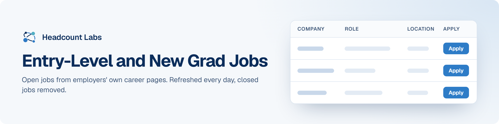

# Entry-Level and New Grad Jobs

Entry-level, new graduate, junior and early-career jobs in every field at US employers.

**273 open jobs** · 59 new since the last update · 21 removed because they closed or left the employer's board · updated November 17, 2026 at 4:38 AM EST

This list is built and refreshed every day by [Headcount Labs](https://headcountlabs.com/?utm_source=github&utm_medium=job-list&utm_campaign=entry-level-jobs), which reads jobs straight from employers' own career pages and job boards. Every job here was still listed on its source board when we last read that board, within the past 3 days, and was posted in the past 30 days. Copies of the same job are merged into one row, and jobs that close are removed at the next update.

Want this data in your own app or agent? Use the [Headcount Labs jobs API](https://headcountlabs.com/docs/?utm_source=github&utm_medium=job-list&utm_campaign=entry-level-jobs) (free tier), the [MCP server](https://headcountlabs.com/mcp/?utm_source=github&utm_medium=job-list&utm_campaign=entry-level-jobs) for Claude, ChatGPT and other AI assistants, or the [public dataset subsets](https://huggingface.co/HeadcountLabs) on Hugging Face (the full dataset is coming soon).

**Jump to:** [Software engineering (22)](#software-engineering) · [Data, AI and machine learning (7)](#data-ai-and-machine-learning) · [Product and design (10)](#product-and-design) · [Hardware and engineering (61)](#hardware-and-engineering) · [Business, finance and operations (42)](#business-finance-and-operations) · [Healthcare (23)](#healthcare) · [Other roles (108)](#other-roles)

**Columns.** *Apply* opens the original posting on the employer's site. *Details* opens the job on Headcount Labs, with every posting we found for it. *Remote* shows what the employer states; a dash means the posting doesn't say. *Pay* is the range the employer published.

## Software engineering

| Company | Role | Location | Remote | Pay | Posted | Apply | Details |
| --- | --- | --- | --- | --- | --- | :---: | :---: |
| **Diodes Incorporated** | Cyber Defense Analyst I (Junior Security Engineer) | Plano, TX | — | — | Nov 15 |  | <a href="https://headcountlabs.com/catalog/jobs/349f90df-8445-4768-9461-0377fe324108?utm_source=github&utm_medium=job-list&utm_campaign=entry-level-jobs">via Headcount Labs</a> |
| **Leidos** | Cyberspace Operations Planner, Junior | Fort Meade, MD | — | $51k–$92k/yr | Nov 14 |  | <a href="https://headcountlabs.com/catalog/jobs/76c214bf-e720-40ee-8e84-996c367815fd?utm_source=github&utm_medium=job-list&utm_campaign=entry-level-jobs">via Headcount Labs</a> |
| **Quartermaster** | Junior RF Test Engineer | 

2 locations
Columbia, MD Arlington, VA
 | On-site | $140k–$155k/yr | Nov 13 |  | <a href="https://headcountlabs.com/catalog/jobs/4f849f19-bd92-4383-9318-4ceae6b3bebf?utm_source=github&utm_medium=job-list&utm_campaign=entry-level-jobs">via Headcount Labs</a> |
| **Amphenol and its Affiliated Companies** | Junior Software Engineer (IT) | Liberty Lake, WA | On-site | $75k–$90k/yr | Nov 13 |  | <a href="https://headcountlabs.com/catalog/jobs/ae9c0380-1252-4655-ab72-7fce0fc576d0?utm_source=github&utm_medium=job-list&utm_campaign=entry-level-jobs">via Headcount Labs</a> |
| **SpaceX** | New Graduate Engineer, Aerospace Software (Starfall) | Hawthorne, CA | — | $125k–$160k/yr | Nov 12 |  | <a href="https://headcountlabs.com/catalog/jobs/b7e52e0f-8ef0-4cb1-a75f-3bc3ab32942d?utm_source=github&utm_medium=job-list&utm_campaign=entry-level-jobs">via Headcount Labs</a> |
| **Sandia National Laboratories** | Early Career Computer Scientist - Satellite Ground Software Modernization (Java), Onsite | Albuquerque, NM | On-site | $102k–$200k/yr | Nov 12 |  | <a href="https://headcountlabs.com/catalog/jobs/bbd7d129-906c-46f9-9feb-8d4a3eb4f619?utm_source=github&utm_medium=job-list&utm_campaign=entry-level-jobs">via Headcount Labs</a> |
| **CGI Technologies and Solutions, Inc.** | Software Developer – Entry Level (January Start) | Knoxville, TN | — | $58k–$96k/yr | Nov 12 |  | <a href="https://headcountlabs.com/catalog/jobs/66a6f38b-354e-4d1b-8ddd-f125eac3db09?utm_source=github&utm_medium=job-list&utm_campaign=entry-level-jobs">via Headcount Labs</a> |
| **Rectangle Health** | Junior Power BI Developer | White Plains, NY | On-site | $75k–$100k/yr | Nov 11 |  | <a href="https://headcountlabs.com/catalog/jobs/305e802b-1966-4d9c-bc13-fe1c3ecd6fd6?utm_source=github&utm_medium=job-list&utm_campaign=entry-level-jobs">via Headcount Labs</a> |
| **Kyndryl Nederland B.V.** | Early Career Consult Program – Cybersecurity Engineer | United States | Hybrid | — | Nov 10 |  | <a href="https://headcountlabs.com/catalog/jobs/fa22df20-1b94-4248-9d41-2793cb1291a1?utm_source=github&utm_medium=job-list&utm_campaign=entry-level-jobs">via Headcount Labs</a> |
| **Ford Global** | Embedded Application Developer - Early Career Program, Advanced EV | Palo Alto, CA | Hybrid | — | Nov 10 |  | <a href="https://headcountlabs.com/catalog/jobs/66d1a0b4-cd8d-4c93-9c96-554d022b41bf?utm_source=github&utm_medium=job-list&utm_campaign=entry-level-jobs">via Headcount Labs</a> |
| **Anduril Industries** | 2027 New Grad Information Security Engineer | Costa Mesa, CA | — | $88k–$117k/yr | Nov 10 |  | <a href="https://headcountlabs.com/catalog/jobs/b3725877-36a3-4d3d-bf47-a7b6635b39ae?utm_source=github&utm_medium=job-list&utm_campaign=entry-level-jobs">via Headcount Labs</a> |
| **CGI Technologies and Solutions, Inc.** | Software Developer – Entry Level | Lafayette, LA | — | $52k–$96k/yr | Nov 7 |  | <a href="https://headcountlabs.com/catalog/jobs/d390edb7-6fd4-4009-a31d-b69203f6fa73?utm_source=github&utm_medium=job-list&utm_campaign=entry-level-jobs">via Headcount Labs</a> |
| **CGI Technologies and Solutions, Inc.** | Software Developer – Entry Level (Top Secret Clearance Required) | Fairfax, VA | — | $58k–$105k/yr | Nov 6 |  | <a href="https://headcountlabs.com/catalog/jobs/99612bc7-fc8d-4c19-acf0-e13bb51f0b0a?utm_source=github&utm_medium=job-list&utm_campaign=entry-level-jobs">via Headcount Labs</a> |
| **Stellantis** | Onboard Junior Software Enginner | Auburn Hills, MI | — | — | Nov 4 |  | <a href="https://headcountlabs.com/catalog/jobs/0d564ad6-e242-4804-a456-c90e7686d2cd?utm_source=github&utm_medium=job-list&utm_campaign=entry-level-jobs">via Headcount Labs</a> |
| **Akima, LLC** | Web Developer, Junior (Active Secret Clearance or Able to Obtain) | Orlando, FL | On-site | — | Nov 4 |  | <a href="https://headcountlabs.com/catalog/jobs/7e844008-4b30-4b62-9f9d-6659ffed9773?utm_source=github&utm_medium=job-list&utm_campaign=entry-level-jobs">via Headcount Labs</a> |
| **SAIC** | Java Developer / Automation Test Engineer Junior | Ashburn, VA | — | $60k–$100k/yr | Nov 3 |  | <a href="https://headcountlabs.com/catalog/jobs/f43ee7c8-9118-4555-8578-90564efae0f9?utm_source=github&utm_medium=job-list&utm_campaign=entry-level-jobs">via Headcount Labs</a> |
| **SAIC** | Java Backend Developer Junior | Ashburn, VA | Hybrid | $60k–$100k/yr | Nov 3 |  | <a href="https://headcountlabs.com/catalog/jobs/7d5f236b-ffe4-4109-8166-2f025947b11d?utm_source=github&utm_medium=job-list&utm_campaign=entry-level-jobs">via Headcount Labs</a> |
| **Lockheed Martin** | Entry-Level Test Engineer - Missile/Sensor Systems | Orlando, FL | — | $58k–$108k/yr | Nov 3 |  | <a href="https://headcountlabs.com/catalog/jobs/7eabee0b-04a6-4e2d-9272-a93a86628cce?utm_source=github&utm_medium=job-list&utm_campaign=entry-level-jobs">via Headcount Labs</a> |
| **Automated Health Systems** | Junior Software Developer | Pittsburgh, PA | — | — | Nov 3 |  | <a href="https://headcountlabs.com/catalog/jobs/fbdaa908-c40a-42e2-bd34-4b924ea738ae?utm_source=github&utm_medium=job-list&utm_campaign=entry-level-jobs">via Headcount Labs</a> |
| **True Anomaly** | Software Engineer I, QA (New Grad) | 

2 locations
Denver, CO Long Beach, CA
 | On-site | $70k/yr | Oct 22 |  | <a href="https://headcountlabs.com/catalog/jobs/fe2c9806-34cd-47f1-a077-8ca2ec68e8fc?utm_source=github&utm_medium=job-list&utm_campaign=entry-level-jobs">via Headcount Labs</a> |
| **SAIC** | Java Developer Junior | Ashburn, VA | Hybrid | $60k–$100k/yr | Oct 22 |  | <a href="https://headcountlabs.com/catalog/jobs/2443f285-44cd-4271-bf1b-afd78158c045?utm_source=github&utm_medium=job-list&utm_campaign=entry-level-jobs">via Headcount Labs</a> |
| **CENTRL** | Junior Software Engineer - Client Services | Mountain View, CA | On-site | — | Oct 19 |  | <a href="https://headcountlabs.com/catalog/jobs/73bd5c82-671f-469d-88ad-1fa915b4f599?utm_source=github&utm_medium=job-list&utm_campaign=entry-level-jobs">via Headcount Labs</a> |

## Data, AI and machine learning

| Company | Role | Location | Remote | Pay | Posted | Apply | Details |
| --- | --- | --- | --- | --- | --- | :---: | :---: |
| **The Vanguard Group, Inc.** | Junior Investment Data Analyst | Scottsdale, AZ | On-site | — | Nov 13 |  | <a href="https://headcountlabs.com/catalog/jobs/6334a11e-465d-4441-afbe-17fd0c3a330a?utm_source=github&utm_medium=job-list&utm_campaign=entry-level-jobs">via Headcount Labs</a> |
| **J-Mack Technologies** | IT Support Technician - Data Technician (Entry Level) | United States | Remote | — | Nov 13 |  | <a href="https://headcountlabs.com/catalog/jobs/03b1d28b-3730-45a3-917a-1af5d96af235?utm_source=github&utm_medium=job-list&utm_campaign=entry-level-jobs">via Headcount Labs</a> |
| **Beth Israel Lahey Health Performance Network, LLC** | Provider Data Management Specialist &#124; Entry Level &#124; Hybrid/Remote Schedule | United States | Hybrid | $25–$38/hr | Nov 13 |  | <a href="https://headcountlabs.com/catalog/jobs/a0ed456d-b15b-4d93-9402-c10824ab57c9?utm_source=github&utm_medium=job-list&utm_campaign=entry-level-jobs">via Headcount Labs</a> |
| **Ericsson** | Data Center Technician I - Entry Level | Ohio | — | — | Nov 11 |  | <a href="https://headcountlabs.com/catalog/jobs/6f3d1c61-b1a6-4707-ab96-4cce84caf2b7?utm_source=github&utm_medium=job-list&utm_campaign=entry-level-jobs">via Headcount Labs</a> |
| **Kyndryl, Inc.** | Early Career Consult Program - Associate Data Engineer | United States | Hybrid | — | Nov 9 |  | <a href="https://headcountlabs.com/catalog/jobs/4a6d7751-6575-407a-8bd6-b507e7db2a79?utm_source=github&utm_medium=job-list&utm_campaign=entry-level-jobs">via Headcount Labs</a> |
| **PepsiCo** | R&amp;D Ops &amp; Meas Sci Junior Scientist | Plano, TX | — | $55k–$82k/yr | Nov 4 |  | <a href="https://headcountlabs.com/catalog/jobs/a28079c4-0310-48ed-9973-8af8b51059ab?utm_source=github&utm_medium=job-list&utm_campaign=entry-level-jobs">via Headcount Labs</a> |
| **Prolific Academic Ltd** | Junior Doctor - AI Research Participants - United States (Remote) | United States | Remote | $130/hr | Oct 29 |  | <a href="https://headcountlabs.com/catalog/jobs/1b0de3cc-e590-4ae9-8784-2e3daba1c20c?utm_source=github&utm_medium=job-list&utm_campaign=entry-level-jobs">via Headcount Labs</a> |

## Product and design

| Company | Role | Location | Remote | Pay | Posted | Apply | Details |
| --- | --- | --- | --- | --- | --- | :---: | :---: |
| **Systems Application &amp; Technologies Inc** | Junior Mechanical Design Engineer | Patuxent River, MD | — | $80k–$145k/yr | Nov 16 |  | <a href="https://headcountlabs.com/catalog/jobs/e1e4b1cc-0ae3-47fd-b0cd-721a9bdd5ee5?utm_source=github&utm_medium=job-list&utm_campaign=entry-level-jobs">via Headcount Labs</a> |
| **The Boeing Company** | C-17 Design and Analysis Engineer (Entry Level or Associate) | Oklahoma City, OK | On-site | $69k–$93k/yr | Nov 13 |  | <a href="https://headcountlabs.com/catalog/jobs/fad0de5b-ce00-4423-9eec-d3a98cabe23a?utm_source=github&utm_medium=job-list&utm_campaign=entry-level-jobs">via Headcount Labs</a> |
| **Stellantis** | Entry Level Powertrain Designer | Auburn Hills, MI | — | — | Nov 13 |  | <a href="https://headcountlabs.com/catalog/jobs/81cf5f14-fd4e-4e9f-9f26-b30e3042ef47?utm_source=github&utm_medium=job-list&utm_campaign=entry-level-jobs">via Headcount Labs</a> |
| **IMEG Consultants Corp.** | Technology Designer New Graduate &#124; St. Louis, MO | Saint Louis, MO | — | — | Nov 13 |  | <a href="https://headcountlabs.com/catalog/jobs/c740b1b2-c675-4296-8e17-107fce2666f8?utm_source=github&utm_medium=job-list&utm_campaign=entry-level-jobs">via Headcount Labs</a> |
| **Stantec** | Junior Mechanical Piping Technologist / Designer | 

4 locations
Bakersfield, TX Amarillo, TX Bakersfield, AZ Phoenix, AZ
 | — | $56k–$76k/yr | Nov 12 |  | <a href="https://headcountlabs.com/catalog/jobs/4af2385c-eee9-408e-8c0a-8fb472b3259a?utm_source=github&utm_medium=job-list&utm_campaign=entry-level-jobs">via Headcount Labs</a> |
| **Sandia National Laboratories** | Mid-Early Career R&amp;D Computer Aided Design and Drafting Technologist, Onsite | Livermore, CA | On-site | $76k–$147k/yr | Nov 11 |  | <a href="https://headcountlabs.com/catalog/jobs/14fa2018-7648-491e-89c9-b410495a19b9?utm_source=github&utm_medium=job-list&utm_campaign=entry-level-jobs">via Headcount Labs</a> |
| **The Boeing Company** | Entry Level Electrical Design Engineer | Hazelwood, MO | On-site | $74k–$100k/yr | Nov 10 |  | <a href="https://headcountlabs.com/catalog/jobs/34c4fe99-baa5-4218-8765-dd5f0c770d6b?utm_source=github&utm_medium=job-list&utm_campaign=entry-level-jobs">via Headcount Labs</a> |
| **Benefit Cosmetics** | Junior Packaging Designer | San Francisco, CA | — | $75k–$92k/yr | Oct 31 |  | <a href="https://headcountlabs.com/catalog/jobs/db2f2c26-e19d-497f-b794-c6e2983be3b4?utm_source=github&utm_medium=job-list&utm_campaign=entry-level-jobs">via Headcount Labs</a> |
| **Stantec** | Automation Designer-New Graduate 2027 | Chicago, IL | — | $77k–$108k/yr | Oct 23 |  | <a href="https://headcountlabs.com/catalog/jobs/3d18d45f-7bfc-42b4-bc40-feda5779f09c?utm_source=github&utm_medium=job-list&utm_campaign=entry-level-jobs">via Headcount Labs</a> |
| **Stantec** | Acoustical Designer-New Graduate 2027 | 

2 locations
Chicago, TX Houston, TX
 | — | $77k–$108k/yr | Oct 23 |  | <a href="https://headcountlabs.com/catalog/jobs/d3fa0f9e-4998-4d90-9d2b-407fc6be7292?utm_source=github&utm_medium=job-list&utm_campaign=entry-level-jobs">via Headcount Labs</a> |

## Hardware and engineering

| Company | Role | Location | Remote | Pay | Posted | Apply | Details |
| --- | --- | --- | --- | --- | --- | :---: | :---: |
| **Qnity** | Quality Engineer – Entry Level | Newark, DE | On-site | $59k–$92k/yr | Nov 14 |  | <a href="https://headcountlabs.com/catalog/jobs/c499f6f0-9076-45c0-a8fd-5e98b62650a5?utm_source=github&utm_medium=job-list&utm_campaign=entry-level-jobs">via Headcount Labs</a> |
| **Teledyne** | Junior Manufacturing Engineer | Billerica, MA | — | $63k–$84k/yr | Nov 13 |  | <a href="https://headcountlabs.com/catalog/jobs/1152cbad-d8aa-4c8b-a292-a9911c51615c?utm_source=github&utm_medium=job-list&utm_campaign=entry-level-jobs">via Headcount Labs</a> |
| **Salas O'Brien** | Entry Level Mechanical Engineer | New Orleans, LA | On-site | — | Nov 13 |  | <a href="https://headcountlabs.com/catalog/jobs/b0d033cd-280d-453c-9706-f56043705be4?utm_source=github&utm_medium=job-list&utm_campaign=entry-level-jobs">via Headcount Labs</a> |
| **Kleinfelder Inc** | Entry-Level Electrical Controls Engineer | Perrysburg, OH | — | — | Nov 13 |  | <a href="https://headcountlabs.com/catalog/jobs/e582978b-d9a2-4644-a4d2-0834b0ce67e2?utm_source=github&utm_medium=job-list&utm_campaign=entry-level-jobs">via Headcount Labs</a> |
| **IMEG Consultants Corp.** | Electrical Engineering New Graduate &#124; Madison, WI | Madison, WI | — | $79k–$82k/yr | Nov 13 |  | <a href="https://headcountlabs.com/catalog/jobs/f67973ac-3f2f-48aa-a7e2-9ac5dbbbb0d4?utm_source=github&utm_medium=job-list&utm_campaign=entry-level-jobs">via Headcount Labs</a> |
| **GlobalFoundries** | Facilities Engineering Technician, Bulk &amp; Specialty Gas - Associates Degree (2027 New College Graduate) | Essex Junction, VT | — | $48k–$83k/yr | Nov 13 |  | <a href="https://headcountlabs.com/catalog/jobs/e78db4e3-da55-4011-920a-6df55e9a8c7f?utm_source=github&utm_medium=job-list&utm_campaign=entry-level-jobs">via Headcount Labs</a> |
| **GlobalFoundries** | Position Facilities Engineering Technician, Bulk &amp; Specialty Gas - Associates Degree (2027 New College Graduate) | Essex Junction, VT | — | $48k–$83k/yr | Nov 13 |  | <a href="https://headcountlabs.com/catalog/jobs/d0cac696-bbb9-4c85-b97f-983bb86c9b08?utm_source=github&utm_medium=job-list&utm_campaign=entry-level-jobs">via Headcount Labs</a> |
| **GlobalFoundries** | Industrial Wastewater Treatment Technician, Associates Degree (2027 New College Graduate) | Essex Junction, VT | — | $48k–$83k/yr | Nov 13 |  | <a href="https://headcountlabs.com/catalog/jobs/1eda8305-376c-42ca-8bc4-8b56d0850016?utm_source=github&utm_medium=job-list&utm_campaign=entry-level-jobs">via Headcount Labs</a> |
| **Eurofins** | Upstream Process Development Engineer (Entry Level) | West Point, PA | — | — | Nov 13 |  | <a href="https://headcountlabs.com/catalog/jobs/f19851a3-cb3f-43f8-ba97-2f2922d8bcba?utm_source=github&utm_medium=job-list&utm_campaign=entry-level-jobs">via Headcount Labs</a> |
| **Ericsson** | Integration Engineer (Early Career) | Texas | — | — | Nov 13 |  | <a href="https://headcountlabs.com/catalog/jobs/85c95d9c-c160-428e-a0aa-98be00775a00?utm_source=github&utm_medium=job-list&utm_campaign=entry-level-jobs">via Headcount Labs</a> |
| **Dewberry** | Entry Level Site/Civil Engineer | Virginia Beach, VA | — | $77k–$80k/yr | Nov 13 |  | <a href="https://headcountlabs.com/catalog/jobs/59ed5f62-d68e-464d-b328-18df4a7e9456?utm_source=github&utm_medium=job-list&utm_campaign=entry-level-jobs">via Headcount Labs</a> |
| **Bechtel Corporation** | 27 New Grad &#124; US &#124; Civil Field Eng | United States | — | $81k–$97k/yr | Nov 13 |  | <a href="https://headcountlabs.com/catalog/jobs/44c0b174-16fc-4bad-840b-4f104fad5878?utm_source=github&utm_medium=job-list&utm_campaign=entry-level-jobs">via Headcount Labs</a> |
| **Axiom Space** | Mission Operations Engineer (Entry Level) | Houston | — | — | Nov 13 |  | <a href="https://headcountlabs.com/catalog/jobs/847aa5ff-b39b-461b-8718-52bfe94e194d?utm_source=github&utm_medium=job-list&utm_campaign=entry-level-jobs">via Headcount Labs</a> |
| **Sandia National Laboratories** | Early Career R&amp;D Mechanical Engineer - Mechanical Purchased Product Engineer, Onsite | Albuquerque, NM | On-site | $102k–$200k/yr | Nov 12 |  | <a href="https://headcountlabs.com/catalog/jobs/d2716722-786c-4fc9-8a52-d6e8a34d49ab?utm_source=github&utm_medium=job-list&utm_campaign=entry-level-jobs">via Headcount Labs</a> |
| **Fluor** | Infrastructure Construction Engineer- New Grad | Austin, TX | — | $54k–$100k/yr | Nov 12 |  | <a href="https://headcountlabs.com/catalog/jobs/4acbec92-8555-41a4-a388-8627493b7204?utm_source=github&utm_medium=job-list&utm_campaign=entry-level-jobs">via Headcount Labs</a> |
| **Actalent** | Entry Level Electrical Drafter | Lake Mary, FL | On-site | $24–$30/hr | Nov 12 |  | <a href="https://headcountlabs.com/catalog/jobs/3117c128-69ca-493c-8f99-b5c1c9c7f07c?utm_source=github&utm_medium=job-list&utm_campaign=entry-level-jobs">via Headcount Labs</a> |
| **Bechtel Corporation** | 27 New Grad &#124; US &#124; Civil Engr | United States | — | $82k–$99k/yr | Nov 10 |  | <a href="https://headcountlabs.com/catalog/jobs/d80b10a8-d03b-4cf3-a002-dedae51f3931?utm_source=github&utm_medium=job-list&utm_campaign=entry-level-jobs">via Headcount Labs</a> |
| **Bechtel Corporation** | 27 New Grad &#124; US &#124; Industrial Hygiene | 

3 locations
United States Houston, TX Reston, VA
 | — | $74k–$89k/yr | Nov 10 |  | <a href="https://headcountlabs.com/catalog/jobs/d60efe3e-f420-48ee-804f-dfad381c3848?utm_source=github&utm_medium=job-list&utm_campaign=entry-level-jobs">via Headcount Labs</a> |
| **Anduril Industries** | Early Career RF Mission Systems Engineer, Air Dominance &amp; Strike | Costa Mesa, CA | — | $120k–$153k/yr | Nov 10 |  | <a href="https://headcountlabs.com/catalog/jobs/09901742-7bda-4770-9f5c-87c9cac397af?utm_source=github&utm_medium=job-list&utm_campaign=entry-level-jobs">via Headcount Labs</a> |
| **Sandia National Laboratories** | Early Career R&amp;D S&amp;E, Systems Engineering - PRIDE Emissaries System Engineer, Onsite | Albuquerque, NM | On-site | $102k–$200k/yr | Nov 9 |  | <a href="https://headcountlabs.com/catalog/jobs/f2a67a95-c285-457e-9b58-8116ffa0e96c?utm_source=github&utm_medium=job-list&utm_campaign=entry-level-jobs">via Headcount Labs</a> |
| **Sandia National Laboratories** | Early Career R&amp;D Mechanical Engineer - National Security Products Center, NM/CA, Onsite | Livermore, CA | On-site | $122k–$238k/yr | Nov 7 |  | <a href="https://headcountlabs.com/catalog/jobs/1795608b-00f3-4a0a-8a36-798838b1f40f?utm_source=github&utm_medium=job-list&utm_campaign=entry-level-jobs">via Headcount Labs</a> |
| **SpaceX** | New Graduate Engineer, Mechanical | McGregor, TX | — | — | Nov 6 |  | <a href="https://headcountlabs.com/catalog/jobs/e2a62f42-bba3-4ed8-821b-6936b79ae0ff?utm_source=github&utm_medium=job-list&utm_campaign=entry-level-jobs">via Headcount Labs</a> |
| **Sandia National Laboratories** | Early-Career R&amp;D Electrical Engineer - System Test and Integration, Onsite | Albuquerque, NM | On-site | $102k–$200k/yr | Nov 6 |  | <a href="https://headcountlabs.com/catalog/jobs/cd701196-dc83-486a-ac87-bea4a221796e?utm_source=github&utm_medium=job-list&utm_campaign=entry-level-jobs">via Headcount Labs</a> |
| **Colliers Engineering &amp; Design** | Entry Level Civil Engineer | Holmdel, NJ | — | $79k–$93k/yr | Nov 6 |  | <a href="https://headcountlabs.com/catalog/jobs/40a834fb-4d29-4b87-96a2-2a4e76b792cf?utm_source=github&utm_medium=job-list&utm_campaign=entry-level-jobs">via Headcount Labs</a> |
| **The Boeing Company** | Structural Analysis Engineer (Entry Level &amp; Associate) | Oklahoma City, OK | On-site | $66k–$90k/yr | Nov 5 |  | <a href="https://headcountlabs.com/catalog/jobs/36e3a548-2ba2-4bc8-9126-1795b803dfd2?utm_source=github&utm_medium=job-list&utm_campaign=entry-level-jobs">via Headcount Labs</a> |
| **SpaceX** | New Graduate Engineer, Mechanical - '26/'27 (Starlink/Starmind) | Bastrop, TX | — | — | Nov 5 |  | <a href="https://headcountlabs.com/catalog/jobs/3d152692-9ca1-4ee1-8107-4544b9c78773?utm_source=github&utm_medium=job-list&utm_campaign=entry-level-jobs">via Headcount Labs</a> |
| **SpaceX** | New Graduate Engineer, Electrical - Satellites (Starlink) | Redmond, WA | — | $105k–$145k/yr | Nov 5 |  | <a href="https://headcountlabs.com/catalog/jobs/05cbf16a-5cc7-4a17-ab94-067b03b0c110?utm_source=github&utm_medium=job-list&utm_campaign=entry-level-jobs">via Headcount Labs</a> |
| **SpaceX** | New Graduate Engineer, Mechanical - Satellites (Starlink) | Redmond, WA | — | $100k–$135k/yr | Nov 5 |  | <a href="https://headcountlabs.com/catalog/jobs/1d4c0b64-fbe6-4e5c-b09e-b8acdeafe17b?utm_source=github&utm_medium=job-list&utm_campaign=entry-level-jobs">via Headcount Labs</a> |
| **Colliers Engineering &amp; Design** | Entry Level Civil/Site Engineer | Hamilton, NJ | — | $79k–$93k/yr | Nov 5 |  | <a href="https://headcountlabs.com/catalog/jobs/91e4dee1-239f-460e-b062-acc1668a5356?utm_source=github&utm_medium=job-list&utm_campaign=entry-level-jobs">via Headcount Labs</a> |
| **SAIC** | Junior Hardware Engineer | Huntsville, AL | — | $80k–$120k/yr | Nov 4 |  | <a href="https://headcountlabs.com/catalog/jobs/ff58534c-7f7e-42e8-b410-e35c4beece57?utm_source=github&utm_medium=job-list&utm_campaign=entry-level-jobs">via Headcount Labs</a> |
| **Margaritaville Hotel San Diego Gaslamp Quarter** | Maintenance Engineer - Entry Level | San Diego, CA | — | $26.50–$27/hr | Nov 4 |  | <a href="https://headcountlabs.com/catalog/jobs/3effc41c-428b-4d99-a63d-e7eb83267f0d?utm_source=github&utm_medium=job-list&utm_campaign=entry-level-jobs">via Headcount Labs</a> |
| **Keysight Technologies, Inc.** | Recent Graduate-Process Engineer – Semiconductor Wafer Fabrication | Santa Rosa, CA | On-site | $77k–$191k/yr | Nov 4 |  | <a href="https://headcountlabs.com/catalog/jobs/fdfc1ac5-0ed9-4594-be87-e45a4d3e0aaf?utm_source=github&utm_medium=job-list&utm_campaign=entry-level-jobs">via Headcount Labs</a> |
| **Keysight Technologies, Inc.** | Recent Graduate-Process Engineer – Advanced Semiconductor Packaging | Santa Rosa, CA | On-site | $77k–$191k/yr | Nov 4 |  | <a href="https://headcountlabs.com/catalog/jobs/f21fbfd5-92a1-46b5-a1b3-a150aaf5c00a?utm_source=github&utm_medium=job-list&utm_campaign=entry-level-jobs">via Headcount Labs</a> |
| **Carollo Engineers** | Entry Level Planning Engineer | Walnut Creek, CA | — | $85k–$95k/yr | Nov 4 |  | <a href="https://headcountlabs.com/catalog/jobs/f067bb1f-c344-4b5c-8b9d-c81215fe8058?utm_source=github&utm_medium=job-list&utm_campaign=entry-level-jobs">via Headcount Labs</a> |
| **AECOM** | Entry-Level Civil Engineer - Hiring Event with AECOM - Arlington, VA | Hunt Valley, MD | Hybrid | $70k–$80k/yr | Nov 4 |  | <a href="https://headcountlabs.com/catalog/jobs/f59d33bb-6cd8-49cc-9dde-4f4c12d3c5ad?utm_source=github&utm_medium=job-list&utm_campaign=entry-level-jobs">via Headcount Labs</a> |
| **The Walsh Group** | Project Engineer - Entry Level - December 2026 Grads - La Porte, IN | La Porte, IN | — | — | Nov 3 |  | <a href="https://headcountlabs.com/catalog/jobs/ba7536c8-9607-463e-885a-214c35a6bd18?utm_source=github&utm_medium=job-list&utm_campaign=entry-level-jobs">via Headcount Labs</a> |
| **Ford** | CAE Engineer - Early Career Program, Advanced EV | Long Beach, CA | On-site | — | Nov 2 |  | <a href="https://headcountlabs.com/catalog/jobs/a234b777-a227-4184-9105-dca13b0e84d4?utm_source=github&utm_medium=job-list&utm_campaign=entry-level-jobs">via Headcount Labs</a> |
| **SAIC** | MACH-TB Junior Mission Systems Engineer | 

2 locations
Crane, IN Huntsville, AL
 | On-site | $100k–$140k/yr | Oct 30 |  | <a href="https://headcountlabs.com/catalog/jobs/c54fbe1d-4c61-40a8-9521-1d0fb18bb06d?utm_source=github&utm_medium=job-list&utm_campaign=entry-level-jobs">via Headcount Labs</a> |
| **Olsson** | Entry-Level Geotechnical Engineer (EIT) | 

8 locations
Denver, CO Fayetteville, AR La Vista, NE Lincoln, NE Oklahoma City, OK Olathe, KS Springfield, MO Tempe, AZ
 | — | $79k–$86k/yr | Oct 29 |  | <a href="https://headcountlabs.com/catalog/jobs/a91cabcf-5242-44b7-917b-b014f15b0b22?utm_source=github&utm_medium=job-list&utm_campaign=entry-level-jobs">via Headcount Labs</a> |
| **IES Electrical** | Project Engineer - Entry Level | Austell, GA | — | — | Oct 29 |  | <a href="https://headcountlabs.com/catalog/jobs/632f31e2-11c2-45aa-90b1-31078d355543?utm_source=github&utm_medium=job-list&utm_campaign=entry-level-jobs">via Headcount Labs</a> |
| **IES Electrical** | Entry-Level Electrical Helper | Richmond, VA | — | — | Oct 29 |  | <a href="https://headcountlabs.com/catalog/jobs/b616df86-5b0c-4adf-bff1-c0cd091ee04f?utm_source=github&utm_medium=job-list&utm_campaign=entry-level-jobs">via Headcount Labs</a> |
| **Teradyne** | Applications Engineer - Rotational Development Program, New College Graduate, (North Reading, MA) | North Reading, MA | — | $83k–$132k/yr | Oct 28 |  | <a href="https://headcountlabs.com/catalog/jobs/d7356868-9189-4789-8fae-3801b70c2c33?utm_source=github&utm_medium=job-list&utm_campaign=entry-level-jobs">via Headcount Labs</a> |
| **Anduril Industries** | 2027 New Grad GNC Engineer | Costa Mesa, CA | — | $117k–$154k/yr | Oct 28 |  | <a href="https://headcountlabs.com/catalog/jobs/160161fb-c211-4c0d-8632-aa3afe70a5cf?utm_source=github&utm_medium=job-list&utm_campaign=entry-level-jobs">via Headcount Labs</a> |
| **Wipro Limited** | Junior Forward Deployed Engineer | Plano | — | $65k–$79k/yr | Oct 26 |  | <a href="https://headcountlabs.com/catalog/jobs/3f262dbc-eb94-4ffe-9919-37b65844cf29?utm_source=github&utm_medium=job-list&utm_campaign=entry-level-jobs">via Headcount Labs</a> |
| **Wipro Limited** | Forward Deployed Engineer (Junior FDE) | Seattle | — | $60k–$148k/yr | Oct 26 |  | <a href="https://headcountlabs.com/catalog/jobs/1b772cfc-dbc7-4db6-a8f3-cf29af6275b3?utm_source=github&utm_medium=job-list&utm_campaign=entry-level-jobs">via Headcount Labs</a> |
| **HarperCollins Publishers** | Junior Analyst, Business Process Reengineering (NYC Hybrid) | New York, NY | Hybrid | $65k–$75k/yr | Oct 26 |  | <a href="https://headcountlabs.com/catalog/jobs/5f1a934a-19aa-4cc2-93ae-4915bfe12bf7?utm_source=github&utm_medium=job-list&utm_campaign=entry-level-jobs">via Headcount Labs</a> |
| **UIC Government Services and the Bowhead Family of Companies** | Junior Systems/ S&amp;T Engineer | Stafford, VA | — | $75k–$90k/yr | Oct 24 |  | <a href="https://headcountlabs.com/catalog/jobs/d42c345e-a528-41b3-8843-7da3957041d8?utm_source=github&utm_medium=job-list&utm_campaign=entry-level-jobs">via Headcount Labs</a> |
| **Anduril Industries** | 2027 New Grad Low Observables Engineer | Costa Mesa, CA | — | $88k–$117k/yr | Oct 23 |  | <a href="https://headcountlabs.com/catalog/jobs/11e18bf1-c0e2-4a4e-a88e-b38a302d3449?utm_source=github&utm_medium=job-list&utm_campaign=entry-level-jobs">via Headcount Labs</a> |
| **Teradyne** | Field Applications Engineer, New College Graduate, (Teradyne, Plano TX) | Plano, TX | — | $83k–$132k/yr | Oct 22 |  | <a href="https://headcountlabs.com/catalog/jobs/463d43e8-79ae-4b58-8734-bbdb5041ee72?utm_source=github&utm_medium=job-list&utm_campaign=entry-level-jobs">via Headcount Labs</a> |
| **Simpson Gumpertz &amp; Heger** | Entry-level Engineer, Structural Engineering | Minneapolis, MN | — | $83k–$88k/yr | Oct 22 |  | <a href="https://headcountlabs.com/catalog/jobs/056a2bd6-4889-4e48-9d3f-9356dfb4cbb1?utm_source=github&utm_medium=job-list&utm_campaign=entry-level-jobs">via Headcount Labs</a> |
| **True Anomaly** | Propulsion Engineer I (New Grad) | Denver, CO | On-site | $90k/yr | Oct 21 |  | <a href="https://headcountlabs.com/catalog/jobs/4b7dfdcc-0381-46c7-88c0-7ed289993c13?utm_source=github&utm_medium=job-list&utm_campaign=entry-level-jobs">via Headcount Labs</a> |
| **Teradyne** | Hardware Verification Engineer, New College Graduate, (Teradyne, Agoura Hills, CA) | Agoura Hills, CA | — | $70k–$112k/yr | Oct 21 |  | <a href="https://headcountlabs.com/catalog/jobs/4c3be3d2-6dff-44cf-b562-cb8bcf7066c1?utm_source=github&utm_medium=job-list&utm_campaign=entry-level-jobs">via Headcount Labs</a> |
| **Spirit AeroSystems** | Spirit Defense - Entry-level Research NDI Engineer | Wichita, KS | — | — | Oct 21 |  | <a href="https://headcountlabs.com/catalog/jobs/f0f18d28-80e6-420e-a998-8f1b4d4c7581?utm_source=github&utm_medium=job-list&utm_campaign=entry-level-jobs">via Headcount Labs</a> |
| **AECOM** | Entry-level Civil Engineer | Greenville, SC | Hybrid | $70k–$85k/yr | Oct 21 |  | <a href="https://headcountlabs.com/catalog/jobs/1d063f3c-3e1e-442c-b8b7-41d204efef48?utm_source=github&utm_medium=job-list&utm_campaign=entry-level-jobs">via Headcount Labs</a> |
| **US Tech Solutions** | Entry Level Electrical Engineer - #26-26510 | Tempe, AZ | — | $40–$45/hr | Oct 20 |  | <a href="https://headcountlabs.com/catalog/jobs/6b75695d-fa3a-490e-9c53-93c1ea61a621?utm_source=github&utm_medium=job-list&utm_campaign=entry-level-jobs">via Headcount Labs</a> |
| **CHA Consulting, Inc.** | Entry Level Civil Engineer - Aviation | Rochester, NY | — | $75k–$78k/yr | Oct 20 |  | <a href="https://headcountlabs.com/catalog/jobs/d5104ebe-54ae-4345-9b39-46dc3a0299c3?utm_source=github&utm_medium=job-list&utm_campaign=entry-level-jobs">via Headcount Labs</a> |
| **The Walsh Group** | Project Engineer - Entry Level - Nashville, TN - 2026 - 2027 | Nashville, TN | — | — | Oct 19 |  | <a href="https://headcountlabs.com/catalog/jobs/2900cf80-2919-42e0-b74f-f622ebbce2d6?utm_source=github&utm_medium=job-list&utm_campaign=entry-level-jobs">via Headcount Labs</a> |
| **SpaceX** | New Graduate Engineer, Electrical (Starshield) | Hawthorne, CA | — | $115k–$140k/yr | Oct 19 |  | <a href="https://headcountlabs.com/catalog/jobs/063b92f1-a2e8-4888-a895-a4b4bd2f5727?utm_source=github&utm_medium=job-list&utm_campaign=entry-level-jobs">via Headcount Labs</a> |
| **Keysight Technologies, Inc.** | RF/uW Solutions Engineer, Recent Graduate | El Segundo, CA | — | $97k–$162k/yr | Oct 19 |  | <a href="https://headcountlabs.com/catalog/jobs/03331882-a552-43f6-842b-bac21a31d73f?utm_source=github&utm_medium=job-list&utm_campaign=entry-level-jobs">via Headcount Labs</a> |
| **Anduril Industries** | 2027 Early Career Supply Chain Engineer | Costa Mesa, CA | — | $77k–$114k/yr | Oct 19 |  | <a href="https://headcountlabs.com/catalog/jobs/90f3dc42-1901-4f96-b48d-86aa5de9baf6?utm_source=github&utm_medium=job-list&utm_campaign=entry-level-jobs">via Headcount Labs</a> |
| **Anduril Industries** | 2027 Early Career Warhead Engineer | Costa Mesa, CA | — | $86k–$114k/yr | Oct 19 |  | <a href="https://headcountlabs.com/catalog/jobs/028456f8-928b-4ea8-97c5-b0606db36672?utm_source=github&utm_medium=job-list&utm_campaign=entry-level-jobs">via Headcount Labs</a> |

## Business, finance and operations

| Company | Role | Location | Remote | Pay | Posted | Apply | Details |
| --- | --- | --- | --- | --- | --- | :---: | :---: |
| **Yoder District - Northwestern Mutual** | Entry Level Financial Representative | Fort Collins, CO | — | $65k–$85k/yr | Nov 16 |  | <a href="https://headcountlabs.com/catalog/jobs/a3ab7f47-5267-4920-86e1-3207372bc842?utm_source=github&utm_medium=job-list&utm_campaign=entry-level-jobs">via Headcount Labs</a> |
| **Northwestern Mutual Syracuse** | Financial Representative - Entry Level | Syracuse, NY | — | $60k–$82k/yr | Nov 16 |  | <a href="https://headcountlabs.com/catalog/jobs/e8e253e3-016e-4065-b430-5947ab4c08df?utm_source=github&utm_medium=job-list&utm_campaign=entry-level-jobs">via Headcount Labs</a> |
| **Jackson Hewitt - 4464** | Entry Level Seasonal Tax Preparer | Springfield, MO | — | $15–$16.50/hr | Nov 16 |  | <a href="https://headcountlabs.com/catalog/jobs/4a02af67-2893-4371-a1c5-d093e8df86c1?utm_source=github&utm_medium=job-list&utm_campaign=entry-level-jobs">via Headcount Labs</a> |
| **Path Resorts** | Entry Level Sales Representative | Sanbornton, NH | — | — | Nov 15 |  | <a href="https://headcountlabs.com/catalog/jobs/ee13e149-65a2-4efd-9e4a-9559326d735d?utm_source=github&utm_medium=job-list&utm_campaign=entry-level-jobs">via Headcount Labs</a> |
| **Votaw Precision Technologies, LLC.** | Junior Accountant | Santa Fe Springs, CA | — | $75k–$85k/yr | Nov 14 |  | <a href="https://headcountlabs.com/catalog/jobs/3905ecbb-6d8d-42f9-96ed-d780bebbf53b?utm_source=github&utm_medium=job-list&utm_campaign=entry-level-jobs">via Headcount Labs</a> |
| **TEKsystems** | Entry Level Admin Specialist (Mon-Fri *No Weekends* $21.75/HR) | Martinsburg, WV | Hybrid | $21.50/hr | Nov 14 |  | <a href="https://headcountlabs.com/catalog/jobs/f272d905-7ea4-407e-85d6-0fd5806d854e?utm_source=github&utm_medium=job-list&utm_campaign=entry-level-jobs">via Headcount Labs</a> |
| **The Boeing Company** | Entry Level Methods Process Analyst | North Charleston, SC | On-site | $60k–$82k/yr | Nov 13 |  | <a href="https://headcountlabs.com/catalog/jobs/8c18e4fe-f41d-4b78-9b78-818ddd11e5c1?utm_source=github&utm_medium=job-list&utm_campaign=entry-level-jobs">via Headcount Labs</a> |
| **SpartanX LLC** | Entry-Level Solar Sales Rep | 

5 locations
Akron, OH Dover, DE St. Louis, MO Harrisburg, PA Columbus, OH
 | Remote | — | Nov 13 |  | <a href="https://headcountlabs.com/catalog/jobs/732afff1-37f6-4192-b1e3-0f32693623ae?utm_source=github&utm_medium=job-list&utm_campaign=entry-level-jobs">via Headcount Labs</a> |
| **Sandia National Laboratories** | Early Career HR Operations Generalist - HR Solutions Customer Service, Onsite | Albuquerque, NM | On-site | $42k–$76k/yr | Nov 13 |  | <a href="https://headcountlabs.com/catalog/jobs/69342f6f-790f-4126-a659-2ea59b6b873e?utm_source=github&utm_medium=job-list&utm_campaign=entry-level-jobs">via Headcount Labs</a> |
| **Salesforce, Inc.** | Finance Pathways Rotation Analyst (Early Career) | Indianapolis, IN | — | — | Nov 13 |  | <a href="https://headcountlabs.com/catalog/jobs/1f2dc5ff-4a6f-44db-bdaf-6be6f4632c04?utm_source=github&utm_medium=job-list&utm_campaign=entry-level-jobs">via Headcount Labs</a> |
| **JND** | [Entry Level] HR Specialist - Compensation Analysis &amp; Benchmarking (18601-1) | Plano, TX | On-site | $52–$56/hr | Nov 13 |  | <a href="https://headcountlabs.com/catalog/jobs/1c9085f3-ae2d-4981-98e0-6b88968abc06?utm_source=github&utm_medium=job-list&utm_campaign=entry-level-jobs">via Headcount Labs</a> |
| **Jackson Hewitt - 922** | Bilingual Entry Level Tax Preparer | Phoenix, AZ | — | $17/hr | Nov 13 |  | <a href="https://headcountlabs.com/catalog/jobs/f7411588-ee5a-4339-82db-d466824f530f?utm_source=github&utm_medium=job-list&utm_campaign=entry-level-jobs">via Headcount Labs</a> |
| **Aerotek** | Hiring -Entry Level -Cleanroom Operators , Paying $19/Hr | San Diego, CA | On-site | $19–$19.76/hr | Nov 13 |  | <a href="https://headcountlabs.com/catalog/jobs/e39f1101-a631-465e-a638-bd748af91ce5?utm_source=github&utm_medium=job-list&utm_campaign=entry-level-jobs">via Headcount Labs</a> |
| **Adobe** | 2027 University Graduate - Sales Development Representative | 

10 locations
San Jose Denver Lehi California San Francisco San Jose, CA Denver, CO San Francisco, CA Lehi, UT New York, NY
 | — | $64k–$106k/yr | Nov 13 |  | <a href="https://headcountlabs.com/catalog/jobs/b5ba6650-cba0-4297-aac1-6682d6517dcd?utm_source=github&utm_medium=job-list&utm_campaign=entry-level-jobs">via Headcount Labs</a> |
| **WTW** | Early Careers: Corporate Risk and Broking (CRB) Graduate Development Program Analyst – Client Advocacy, Commercial Lines – Atlanta, Chicago, New York - 2027 | 

3 locations
Atlanta, GA New York, NY Chicago, IL
 | Hybrid | $36–$39/hr | Nov 11 |  | <a href="https://headcountlabs.com/catalog/jobs/f1729a4c-b37e-46b8-86ee-6c9b985b476c?utm_source=github&utm_medium=job-list&utm_campaign=entry-level-jobs">via Headcount Labs</a> |
| **SAIC** | Junior Configuration Analyst | Middletown, RI | — | $40k–$80k/yr | Nov 11 |  | <a href="https://headcountlabs.com/catalog/jobs/a9dd9286-2b0e-487b-96d5-c42362a016c6?utm_source=github&utm_medium=job-list&utm_campaign=entry-level-jobs">via Headcount Labs</a> |
| **Remington Hotels** | Entry Level Accounting Clerk | Fort Worth, TX | On-site | — | Nov 11 |  | <a href="https://headcountlabs.com/catalog/jobs/a3b02a9d-eba4-4c38-a1bc-ad56e0c572bf?utm_source=github&utm_medium=job-list&utm_campaign=entry-level-jobs">via Headcount Labs</a> |
| **IES Residential** | HR Specialist (Entry-Level) | Sugar Land, TX | — | — | Nov 11 |  | <a href="https://headcountlabs.com/catalog/jobs/10ecdf2a-67a5-4cab-b268-692eaa2be465?utm_source=github&utm_medium=job-list&utm_campaign=entry-level-jobs">via Headcount Labs</a> |
| **Bechtel Corporation** | 27 New Grad &#124; US &#124; Human Resources | 

4 locations
United States Glendale, AZ Houston, TX Reston, VA
 | — | $70k–$84k/yr | Nov 11 |  | <a href="https://headcountlabs.com/catalog/jobs/3ce21ffe-e6b0-4f96-ab14-6e3e497c179d?utm_source=github&utm_medium=job-list&utm_campaign=entry-level-jobs">via Headcount Labs</a> |
| **Akima, LLC** | Junior Financial Analyst (Active Secret Clearance or ability to obtain) | Fort Belvoir, VA | — | $52k–$55k/yr | Nov 11 |  | <a href="https://headcountlabs.com/catalog/jobs/50863b25-0c4e-4241-93f9-71a89b69b616?utm_source=github&utm_medium=job-list&utm_campaign=entry-level-jobs">via Headcount Labs</a> |
| **UIC Government Services and the Bowhead Family of Companies** | Junior Power BI and Power Platform Analyst | Aberdeen, MD | — | $70k–$90k/yr | Nov 10 |  | <a href="https://headcountlabs.com/catalog/jobs/12271694-717e-4eb0-a73f-bd20947e86e6?utm_source=github&utm_medium=job-list&utm_campaign=entry-level-jobs">via Headcount Labs</a> |
| **Delta Airport Consultants** | Proposal Coordinator / Marketing Specialist (Richmond, VA) (entry-level) | Richmond, VA | On-site | $55k–$60k/yr | Nov 10 |  | <a href="https://headcountlabs.com/catalog/jobs/dac73fbd-c675-4f83-bf9c-df6a6964d8dd?utm_source=github&utm_medium=job-list&utm_campaign=entry-level-jobs">via Headcount Labs</a> |
| **Centria Autism** | Entry Level Operations Role | 

2 locations
Lawrence, IN Speedway, IN
 | — | $22–$24/hr | Nov 10 |  | <a href="https://headcountlabs.com/catalog/jobs/51c644ab-b4fe-47ad-ab15-11c8fba44f8f?utm_source=github&utm_medium=job-list&utm_campaign=entry-level-jobs">via Headcount Labs</a> |
| **Anduril Industries** | 2027 Early Career Finance Emerging Leadership Rotational Program | Costa Mesa, CA | — | $78k–$104k/yr | Nov 10 |  | <a href="https://headcountlabs.com/catalog/jobs/eb3046e2-594c-49cc-92b9-d35fd3d41e39?utm_source=github&utm_medium=job-list&utm_campaign=entry-level-jobs">via Headcount Labs</a> |
| **Spirit AeroSystems** | Spirit Defense - Entry-Level Integrated Business Teams Leader | Wichita, KS | — | — | Nov 9 |  | <a href="https://headcountlabs.com/catalog/jobs/7a1583f7-fa24-401f-b870-631bc5415119?utm_source=github&utm_medium=job-list&utm_campaign=entry-level-jobs">via Headcount Labs</a> |
| **MLM Home Improvement** | Entry Level Sales | Bel Air, MD | On-site | $60k–$110k/yr | Nov 5 |  | <a href="https://headcountlabs.com/catalog/jobs/9dbdc36d-f238-455c-8c04-7a6af76b13e6?utm_source=github&utm_medium=job-list&utm_campaign=entry-level-jobs">via Headcount Labs</a> |
| **Arthrex Indianapolis** | Orthopedic Sales Representative - Entry Level | South Bend, IN | On-site | $50k–$60k/yr | Nov 4 |  | <a href="https://headcountlabs.com/catalog/jobs/c4ee03a7-8b36-4ad5-9cb0-c64f87606296?utm_source=github&utm_medium=job-list&utm_campaign=entry-level-jobs">via Headcount Labs</a> |
| **Allwyn Corp** | Junior Accountant | Allwyn US | Remote | — | Nov 3 |  | <a href="https://headcountlabs.com/catalog/jobs/62723e99-8728-4b33-b7e8-3a7001ea3f27?utm_source=github&utm_medium=job-list&utm_campaign=entry-level-jobs">via Headcount Labs</a> |
| **Sunrun** | Entry Level Sales Representative | Santa Ana, CA | — | $75k–$90k/yr | Nov 1 |  | <a href="https://headcountlabs.com/catalog/jobs/be7f8ce3-a486-4632-8cc6-316a8d274030?utm_source=github&utm_medium=job-list&utm_campaign=entry-level-jobs">via Headcount Labs</a> |
| **Boostlingo** | Junior Attorney / Paralegal, Sales Contracts | United States | Remote | — | Oct 31 |  | <a href="https://headcountlabs.com/catalog/jobs/a154e676-812a-45b4-8da7-09c025b273e0?utm_source=github&utm_medium=job-list&utm_campaign=entry-level-jobs">via Headcount Labs</a> |
| **Penske Automotive** | Junior Sales Consultant | Warwick, RI | — | $100k/yr | Oct 30 |  | <a href="https://headcountlabs.com/catalog/jobs/5633e2ff-3d0c-4bd7-b652-e5e8737c269c?utm_source=github&utm_medium=job-list&utm_campaign=entry-level-jobs">via Headcount Labs</a> |
| **Infiniti of Warwick, a Penske Automotive Group dealership** | Junior Sales Consultant | Warwick, RI | — | — | Oct 30 |  | <a href="https://headcountlabs.com/catalog/jobs/39bd1329-2c96-4411-ac03-e9d3ae25d310?utm_source=github&utm_medium=job-list&utm_campaign=entry-level-jobs">via Headcount Labs</a> |
| **Actalent** | Entry Level Recruiter &#124; Sales Trainee | 

4 locations
Richmond, VA Harrisburg, PA Columbia, MD St Louis Park, MN
 | — | $45k–$55k/yr | Oct 30 |  | <a href="https://headcountlabs.com/catalog/jobs/42291e5d-a0d5-45ec-86c4-8cdc00c5bc42?utm_source=github&utm_medium=job-list&utm_campaign=entry-level-jobs">via Headcount Labs</a> |
| **Reyes Holdings** | Entry Level Sales Associate | Austin, TX | — | $21/hr | Oct 28 |  | <a href="https://headcountlabs.com/catalog/jobs/d79b760f-24eb-4f1b-ba47-01bce09164d4?utm_source=github&utm_medium=job-list&utm_campaign=entry-level-jobs">via Headcount Labs</a> |
| **TiER1 Performance** | Transformation Consultant &#124; Early Career Cohort | Covington, KY | Remote | $65k–$95k/yr | Oct 27 |  | <a href="https://headcountlabs.com/catalog/jobs/6ad2bb88-4780-46fd-aa58-471dd75ea1a3?utm_source=github&utm_medium=job-list&utm_campaign=entry-level-jobs">via Headcount Labs</a> |
| **The Cheesecake Factory** | Junior HRSS Time Off and Benefits Analyst | Calabasas Hills, CA | — | $72k–$80k/yr | Oct 26 |  | <a href="https://headcountlabs.com/catalog/jobs/4046598e-d2f1-4fe8-8475-5f533fda48df?utm_source=github&utm_medium=job-list&utm_campaign=entry-level-jobs">via Headcount Labs</a> |
| **Spirit AeroSystems** | Entry-level Production Control Analyst | Wichita, KS | — | — | Oct 26 |  | <a href="https://headcountlabs.com/catalog/jobs/c6a0aa3f-37a4-438b-acad-6a52b6a45d3d?utm_source=github&utm_medium=job-list&utm_campaign=entry-level-jobs">via Headcount Labs</a> |
| **US Tech Solutions** | Logistics Analyst - Junior # 26-27003 | Framingham, MA | — | $25–$27/hr | Oct 24 |  | <a href="https://headcountlabs.com/catalog/jobs/0dc86aed-447d-48e3-81b1-2f128f8404b6?utm_source=github&utm_medium=job-list&utm_campaign=entry-level-jobs">via Headcount Labs</a> |
| **Cayuse Holdings** | Religious Freedom Analyst, Junior | Washington, DC | — | $47.59–$52.40/hr | Oct 24 |  | <a href="https://headcountlabs.com/catalog/jobs/9f74d8ea-aaea-4fbc-a54b-3be1c1c49860?utm_source=github&utm_medium=job-list&utm_campaign=entry-level-jobs">via Headcount Labs</a> |
| **US Tech Solutions** | Junior Business Analyst # 26-26855 | Columbia, SC | — | $34.12/hr | Oct 23 |  | <a href="https://headcountlabs.com/catalog/jobs/96c4e8f3-7720-47f6-b6bf-71884b45dcbc?utm_source=github&utm_medium=job-list&utm_campaign=entry-level-jobs">via Headcount Labs</a> |
| **Keysight Technologies, Inc.** | Inside Sales Representative, Recent Graduate | Santa Clara, CA | — | $169k–$282k/yr | Oct 22 |  | <a href="https://headcountlabs.com/catalog/jobs/369415c9-c2a9-4c15-b4af-441e701c8a0d?utm_source=github&utm_medium=job-list&utm_campaign=entry-level-jobs">via Headcount Labs</a> |
| **Anduril Industries** | 2027 Early Career Business Operations Analyst | 

3 locations
Costa Mesa, CA Seattle, WA Washington, DC
 | — | $78k–$104k/yr | Oct 21 |  | <a href="https://headcountlabs.com/catalog/jobs/b1ec11a8-7df3-401a-8b49-03fdb5a7cc49?utm_source=github&utm_medium=job-list&utm_campaign=entry-level-jobs">via Headcount Labs</a> |

## Healthcare

| Company | Role | Location | Remote | Pay | Posted | Apply | Details |
| --- | --- | --- | --- | --- | --- | :---: | :---: |
| **Yale New Haven Health** | RN New Grad Residency- 2026-Ortho/Spine | New Haven, CT | — | — | Nov 16 |  | <a href="https://headcountlabs.com/catalog/jobs/a91e901a-2fba-4a46-9789-6bbbde2a78b2?utm_source=github&utm_medium=job-list&utm_campaign=entry-level-jobs">via Headcount Labs</a> |
| **University Hospitals Career Section** | Registered Nurse (New Grad) Medical Surgical | Elyria, OH | — | — | Nov 13 |  | <a href="https://headcountlabs.com/catalog/jobs/82766a93-10d1-4517-8eca-d700168665c9?utm_source=github&utm_medium=job-list&utm_campaign=entry-level-jobs">via Headcount Labs</a> |
| **UHS** | Registered Nurse (RN) - New Graduate | SOUTH ATTLEBORO, MA | — | — | Nov 13 |  | <a href="https://headcountlabs.com/catalog/jobs/23afb814-0f33-4baf-a232-c18fe72c4537?utm_source=github&utm_medium=job-list&utm_campaign=entry-level-jobs">via Headcount Labs</a> |
| **TRC Total Renal Care Inc** | Entry Level Medical Office Receptionist | Trumbull, CT | On-site | $19–$31.50/hr | Nov 13 |  | <a href="https://headcountlabs.com/catalog/jobs/af4ba8fc-b175-43de-adb8-9f7f5b68206c?utm_source=github&utm_medium=job-list&utm_campaign=entry-level-jobs">via Headcount Labs</a> |
| **Sharp HealthCare** | Nurse Residency Program &#124; New Grad RN &#124; Spring 2027 Start &#124; Sharp HealthCare | San Diego, CA | — | $64.21–$72.97/hr | Nov 13 |  | <a href="https://headcountlabs.com/catalog/jobs/d0b29f8f-1695-47d5-abf0-e00f5628c2fc?utm_source=github&utm_medium=job-list&utm_campaign=entry-level-jobs">via Headcount Labs</a> |
| **Sharp HealthCare** | Nurse Residency Program &#124; New Grad RN &#124; Spring 2027 Start &#124; Sharp Tri-City Medical Center | Oceanside, CA | — | $44.67–$56.76/hr | Nov 13 |  | <a href="https://headcountlabs.com/catalog/jobs/4e46ead9-602b-45d3-99f8-a5236edab658?utm_source=github&utm_medium=job-list&utm_campaign=entry-level-jobs">via Headcount Labs</a> |
| **Leidos** | Junior Amazon Connect System Administrator – DoD Healthcare | United States | Remote | $70k–$126k/yr | Nov 13 |  | <a href="https://headcountlabs.com/catalog/jobs/d000cbfb-c7c7-4ce9-abc2-d97969fc5ced?utm_source=github&utm_medium=job-list&utm_campaign=entry-level-jobs">via Headcount Labs</a> |
| **Lansdale Hospital** | RN - New Grad RN Resource Team - Full Time Nights - Jefferson Lansdale | Montgomery County, PA | — | — | Nov 13 |  | <a href="https://headcountlabs.com/catalog/jobs/619ddd75-8059-4651-9fca-c0e2f343b894?utm_source=github&utm_medium=job-list&utm_campaign=entry-level-jobs">via Headcount Labs</a> |
| **Johns Hopkins Medicine** | New Grad RN - Med Tele | Baltimore, MD | — | $36.07–$54.28/hr | Nov 13 |  | <a href="https://headcountlabs.com/catalog/jobs/95060b40-6f64-4b82-a2d0-a620d730d5c8?utm_source=github&utm_medium=job-list&utm_campaign=entry-level-jobs">via Headcount Labs</a> |
| **Johns Hopkins Medicine** | New Grad RN - NCCU | Baltimore, MD | — | $36.07–$54.28/hr | Nov 13 |  | <a href="https://headcountlabs.com/catalog/jobs/0e31a35c-755f-4c8b-8b50-41746d320135?utm_source=github&utm_medium=job-list&utm_campaign=entry-level-jobs">via Headcount Labs</a> |
| **ESI Esoterix Inc.** | Clinical Lab Technician - Esoterix -Entry level, will train. | Calabasas Hills, CA | — | $24–$30/hr | Nov 13 |  | <a href="https://headcountlabs.com/catalog/jobs/2636572e-f1e3-4de5-8498-e3e9a396137d?utm_source=github&utm_medium=job-list&utm_campaign=entry-level-jobs">via Headcount Labs</a> |
| **Sandia National Laboratories** | Early Career Health Physicist - Radiation Protection Dosimetry, Onsite | Albuquerque, NM | On-site | $87k–$169k/yr | Nov 12 |  | <a href="https://headcountlabs.com/catalog/jobs/468f4cb9-0a0c-4642-9d5f-7ec32f970ad4?utm_source=github&utm_medium=job-list&utm_campaign=entry-level-jobs">via Headcount Labs</a> |
| **Stanford Health Care** | Clinical Nurse I (RN) – New Graduate Nurse Residency - Spring 2027 | Palo Alto, CA | On-site | $92.77/hr | Nov 10 |  | <a href="https://headcountlabs.com/catalog/jobs/e4d398f7-c031-4b89-a0a2-4d69b3ed0146?utm_source=github&utm_medium=job-list&utm_campaign=entry-level-jobs">via Headcount Labs</a> |
| **South Shore Health** | Registered Nurse New Grad Residency – March 2027 Start | Weymouth, MA | On-site | $39.50–$84.02/hr | Nov 9 |  | <a href="https://headcountlabs.com/catalog/jobs/418c2f87-db74-4ed7-bad5-bf24cf15ff7b?utm_source=github&utm_medium=job-list&utm_campaign=entry-level-jobs">via Headcount Labs</a> |
| **FirstHealth of the Carolinas, Inc.** | ICU RN- New Grad Summer Residency | Pinehurst, NC | — | — | Nov 5 |  | <a href="https://headcountlabs.com/catalog/jobs/108510b4-d947-4cc5-bbb8-ea4c11947c3d?utm_source=github&utm_medium=job-list&utm_campaign=entry-level-jobs">via Headcount Labs</a> |
| **BJC HealthCare** | New Graduate Nurse at Memorial Hospital Belleville - Shiloh | Belleville, IL | — | — | Oct 28 |  | <a href="https://headcountlabs.com/catalog/jobs/6b826a63-19b5-45fb-90a1-185b35464c5b?utm_source=github&utm_medium=job-list&utm_campaign=entry-level-jobs">via Headcount Labs</a> |
| **Northpoint Recovery Holdings, LLC** | NEW GRAD Registered Nurse (RN) - Full-Time Days | Loveland, CO | — | $33–$52/hr | Oct 26 |  | <a href="https://headcountlabs.com/catalog/jobs/71ae20fd-f102-4d15-9e03-1cbef369a3ee?utm_source=github&utm_medium=job-list&utm_campaign=entry-level-jobs">via Headcount Labs</a> |
| **Northpoint Recovery Holdings, LLC** | NEW GRAD Licensed Practical Nurse (LPN) - Full-Time Days | Loveland, CO | — | $30–$39/hr | Oct 26 |  | <a href="https://headcountlabs.com/catalog/jobs/335290bc-4cb2-4b33-b16c-cf65580cf22c?utm_source=github&utm_medium=job-list&utm_campaign=entry-level-jobs">via Headcount Labs</a> |
| **ConvenientMD** | New Grad - Physician Associate/Assistant (PA) - Urgent Care | 

3 locations
Waterville, ME Bangor, ME Farmington, ME
 | — | $55–$60/hr | Oct 26 |  | <a href="https://headcountlabs.com/catalog/jobs/f1c15586-4882-4a0a-b113-82cea300097d?utm_source=github&utm_medium=job-list&utm_campaign=entry-level-jobs">via Headcount Labs</a> |
| **ConvenientMD** | New Grad - Family Nurse Practitioner (FNP) - Urgent Care | 

5 locations
Waterville, ME Manchester, NH Bangor, ME Farmington, ME Ellsworth, ME
 | — | $55–$60/hr | Oct 26 |  | <a href="https://headcountlabs.com/catalog/jobs/fe2b5025-9010-45f3-83c5-1e39c42003f1?utm_source=github&utm_medium=job-list&utm_campaign=entry-level-jobs">via Headcount Labs</a> |
| **ConvenientMD** | New Grad - Physician Assistant/Associate (PA) - Urgent Care | Ellsworth, ME | — | $55–$60/hr | Oct 26 |  | <a href="https://headcountlabs.com/catalog/jobs/a026b194-491a-4926-862e-2dc8127e4540?utm_source=github&utm_medium=job-list&utm_campaign=entry-level-jobs">via Headcount Labs</a> |
| **UHS** | Emergency Department - RN New Grad Residency Program - February 2027 Cohort | WASHINGTON | — | — | Oct 23 |  | <a href="https://headcountlabs.com/catalog/jobs/7acbad3f-3fd2-47ff-82f3-5dde9fc1a5b1?utm_source=github&utm_medium=job-list&utm_campaign=entry-level-jobs">via Headcount Labs</a> |
| **Ascension** | New Grad Registered Nurse | 

5 locations
Bartlesville, OK Sapulpa, OK Owasso, OK Broken Arrow, OK Jenks, OK
 | On-site | — | Oct 20 |  | <a href="https://headcountlabs.com/catalog/jobs/9665726a-5e7c-4893-8d19-61fb4b2fe9fc?utm_source=github&utm_medium=job-list&utm_campaign=entry-level-jobs">via Headcount Labs</a> |

## Other roles

| Company | Role | Location | Remote | Pay | Posted | Apply | Details |
| --- | --- | --- | --- | --- | --- | :---: | :---: |
| **Stinson LLP** | Junior Bankruptcy and Creditors' Rights Associate, St. Louis, MO | Clayton, MO | — | — | Nov 16 |  | <a href="https://headcountlabs.com/catalog/jobs/d62255cd-d499-44ea-957b-6971c8a8b811?utm_source=github&utm_medium=job-list&utm_campaign=entry-level-jobs">via Headcount Labs</a> |
| **Stinson LLP** | Junior Bankruptcy and Creditors' Rights Associate, Dallas, TX | Dallas, TX | — | — | Nov 16 |  | <a href="https://headcountlabs.com/catalog/jobs/47d30fbf-2514-438b-8b7d-61c7767e59c6?utm_source=github&utm_medium=job-list&utm_campaign=entry-level-jobs">via Headcount Labs</a> |
| **Go Green Plumbing, Heating, Air &amp; Electrical** | Junior Digital Creator (Part-Time) | Greensboro, NC | — | $18–$25/hr | Nov 16 |  | <a href="https://headcountlabs.com/catalog/jobs/38730efd-27ac-45f6-8c7c-6e9c8154ed0e?utm_source=github&utm_medium=job-list&utm_campaign=entry-level-jobs">via Headcount Labs</a> |
| **Brooklyn Botanic Garden** | Junior Building Custodian | Brooklyn, NY | — | $42k–$45k/yr | Nov 16 |  | <a href="https://headcountlabs.com/catalog/jobs/188a520a-1983-4876-a642-07e699b9b124?utm_source=github&utm_medium=job-list&utm_campaign=entry-level-jobs">via Headcount Labs</a> |
| **Bonnell** | Packing Entry Level- Nightshift | Carthage, TN | On-site | $23.50/hr | Nov 16 |  | <a href="https://headcountlabs.com/catalog/jobs/37079d2b-6c26-4721-8c49-8f4a59c374df?utm_source=github&utm_medium=job-list&utm_campaign=entry-level-jobs">via Headcount Labs</a> |
| **Emerald Blue / Omni Workspace** | Entry Level - Office Furniture Installer | Minneapolis, MN | — | $19–$20/hr | Nov 15 |  | <a href="https://headcountlabs.com/catalog/jobs/c220994d-b8d0-4c5a-94d8-b88248dc36aa?utm_source=github&utm_medium=job-list&utm_campaign=entry-level-jobs">via Headcount Labs</a> |
| **Xtend, Inc** | Entry-Level Bookkeeper | Grand Rapids, MI | — | $16/hr | Nov 14 |  | <a href="https://headcountlabs.com/catalog/jobs/71f266a1-8549-4d63-a5fe-18edd1a81217?utm_source=github&utm_medium=job-list&utm_campaign=entry-level-jobs">via Headcount Labs</a> |
| **Sun Auto Tire and Service** | Junior Automotive Technician | Benton, KY | — | $20–$27/hr | Nov 14 |  | <a href="https://headcountlabs.com/catalog/jobs/bee0d829-b493-48bb-ad75-0e3ef8116b65?utm_source=github&utm_medium=job-list&utm_campaign=entry-level-jobs">via Headcount Labs</a> |
| **Plaza Tire Service** | Junior Automotive Technician | Benton, KY | — | $20–$27/hr | Nov 14 |  | <a href="https://headcountlabs.com/catalog/jobs/9ceaba20-888c-4b51-bfb0-6b566138114d?utm_source=github&utm_medium=job-list&utm_campaign=entry-level-jobs">via Headcount Labs</a> |
| **Petco Animal Supplies Stores, Inc.** | Junior Groomer | 

7 locations
Irondequoit, NY Prince Frederick, MD Kahului, HI Altoona South, PA Lihue, HI Chicago Evergreen, IL Helena, MT
 | — | $10–$19.50/hr | Nov 14 |  | <a href="https://headcountlabs.com/catalog/jobs/bb0b10ee-dcd9-49cf-bdb8-9fb7acd6aa12?utm_source=github&utm_medium=job-list&utm_campaign=entry-level-jobs">via Headcount Labs</a> |
| **Petco** | Junior Groomer | 

8 locations
Irondequoit, NY Helena, MT Bronx, NY Yonkers, NY Lihue, HI Kahului, HI Chicago, IL Clifton Park, NY
 | — | $10–$19.50/hr | Nov 14 |  | <a href="https://headcountlabs.com/catalog/jobs/c8512797-82aa-47bc-872f-345af6bd1ca4?utm_source=github&utm_medium=job-list&utm_campaign=entry-level-jobs">via Headcount Labs</a> |
| **Infinisource Consulting Solutions** | Recent College graduate trainer wanted full time | Alabama | — | — | Nov 14 |  | <a href="https://headcountlabs.com/catalog/jobs/8bac089e-2c59-46f5-9348-5b0d459d5830?utm_source=github&utm_medium=job-list&utm_campaign=entry-level-jobs">via Headcount Labs</a> |
| **Infinisource Consulting Solutions** | Recent Faulkner University graduate full time | Alabama | — | — | Nov 14 |  | <a href="https://headcountlabs.com/catalog/jobs/887e7e16-6523-4828-94b1-ec4fd8a4cffa?utm_source=github&utm_medium=job-list&utm_campaign=entry-level-jobs">via Headcount Labs</a> |
| **Infinisource Consulting Solutions** | Recent Auburn University graduate trainer wanted | Alabama | — | — | Nov 14 |  | <a href="https://headcountlabs.com/catalog/jobs/14409b23-3d98-4eea-a2d2-e4c1dd0d5e8d?utm_source=github&utm_medium=job-list&utm_campaign=entry-level-jobs">via Headcount Labs</a> |
| **CU*Answers** | Entry-Level Compliance Support Associate | Grand Rapids, MI | — | $16/hr | Nov 14 |  | <a href="https://headcountlabs.com/catalog/jobs/e56ac26e-6fce-4793-aaef-5d8ef9700952?utm_source=github&utm_medium=job-list&utm_campaign=entry-level-jobs">via Headcount Labs</a> |
| **BioLife.** | Part Time Entry level Plasma Center Tech, CPT Required, Weekends Required | Sacramento, CA | — | $19/hr | Nov 14 |  | <a href="https://headcountlabs.com/catalog/jobs/5e3b5ce7-64c3-402c-8499-ddb50b9cca3b?utm_source=github&utm_medium=job-list&utm_campaign=entry-level-jobs">via Headcount Labs</a> |
| **BioLife.** | Plasma Center Technician / Entry Level Phlebotom | Greenwood, IN | — | $17/hr | Nov 14 |  | <a href="https://headcountlabs.com/catalog/jobs/5826d347-c7d6-49c7-8622-a31ac7012135?utm_source=github&utm_medium=job-list&utm_campaign=entry-level-jobs">via Headcount Labs</a> |
| **Aerotek** | 3rd Shift Packer, Entry Level | Vernon Hills, IL | On-site | $19/hr | Nov 14 |  | <a href="https://headcountlabs.com/catalog/jobs/b3d2ae5a-784e-401b-929a-7c4829191cbf?utm_source=github&utm_medium=job-list&utm_campaign=entry-level-jobs">via Headcount Labs</a> |
| **United States 1 AB Car Rental Services, Inc** | Entry Level Automotive Technician - FT | East Elmhurst | — | $21/hr | Nov 13 |  | <a href="https://headcountlabs.com/catalog/jobs/5ef545d2-12a0-4604-a7be-e0e88297d043?utm_source=github&utm_medium=job-list&utm_campaign=entry-level-jobs">via Headcount Labs</a> |
| **TEKsystems** | Entry Level IT Field Technician (Traveling Technician) | 

2 locations
Cincinnati, OH Louisville, KY
 | On-site | $23/hr | Nov 13 |  | <a href="https://headcountlabs.com/catalog/jobs/be8d815b-b3c2-4fa5-b187-5f3c225ed6c1?utm_source=github&utm_medium=job-list&utm_campaign=entry-level-jobs">via Headcount Labs</a> |
| **TEKsystems** | Entry Level Install Tech | Alcoa, TN | On-site | $18–$22/hr | Nov 13 |  | <a href="https://headcountlabs.com/catalog/jobs/95561d88-2c3d-4666-b830-493eb4eff702?utm_source=github&utm_medium=job-list&utm_campaign=entry-level-jobs">via Headcount Labs</a> |
| **TEKsystems** | Entry Level Call Center Representative (Immediate Consideration) | Pensacola, FL | Hybrid | $19.75/hr | Nov 13 |  | <a href="https://headcountlabs.com/catalog/jobs/26b31eda-68aa-4781-b268-c41a8ec88b02?utm_source=github&utm_medium=job-list&utm_campaign=entry-level-jobs">via Headcount Labs</a> |
| **Mercy Health BSMH** | Early Career Decision - Ortho Neuro Unit - St. Elizabeth Youngstown Hospital - Ortho Trauma 5 We | 

2 locations
Youngstown, OH United States
 | On-site | — | Nov 13 |  | <a href="https://headcountlabs.com/catalog/jobs/c7d63f30-dc8b-4265-913b-450f31e61d1e?utm_source=github&utm_medium=job-list&utm_campaign=entry-level-jobs">via Headcount Labs</a> |
| **Kyndryl, Inc.** | Entry Level Red Hat Specialist | United States | Hybrid | — | Nov 13 |  | <a href="https://headcountlabs.com/catalog/jobs/c07fb74b-6b31-44b0-8cfb-58a75f4b7130?utm_source=github&utm_medium=job-list&utm_campaign=entry-level-jobs">via Headcount Labs</a> |
| **K Group Companies** | Field Service Technician – Entry Level | Grand Rapids, MI | On-site | — | Nov 13 |  | <a href="https://headcountlabs.com/catalog/jobs/9d046941-703e-479a-a3b7-fb0da260f126?utm_source=github&utm_medium=job-list&utm_campaign=entry-level-jobs">via Headcount Labs</a> |
| **HMC Harvey Mudd College** | Dining Services Junior Cook | Hoch-Shanahan Dining Commons | — | $22.90–$27.50/hr | Nov 13 |  | <a href="https://headcountlabs.com/catalog/jobs/7223f7cc-ea77-499a-8a3d-18f43d400115?utm_source=github&utm_medium=job-list&utm_campaign=entry-level-jobs">via Headcount Labs</a> |
| **Globe Life AO** | __ ✓Remote Client Engagement &#124; Entry Level &#124; Grow With Us | United States | Remote | — | Nov 13 |  | <a href="https://headcountlabs.com/catalog/jobs/226ab5cc-2ec7-4025-bcc1-0a12bc510629?utm_source=github&utm_medium=job-list&utm_campaign=entry-level-jobs">via Headcount Labs</a> |
| **Fiskars Finland Oy Ab** | Fiskars FORGE – R&amp;D Early Career Program (Graduate Trainee) | 

2 locations
Espoo Wisconsin
 | Hybrid | — | Nov 13 |  | <a href="https://headcountlabs.com/catalog/jobs/d57e7955-a6b6-4361-af88-56d528bce73c?utm_source=github&utm_medium=job-list&utm_campaign=entry-level-jobs">via Headcount Labs</a> |
| **Ferguson Fire &amp; Fabrication Inc** | Warehouse Associate - Entry Level | Chicopee, MA | — | — | Nov 13 |  | <a href="https://headcountlabs.com/catalog/jobs/8bf8aed3-1195-44cc-a159-c9886aff1b6c?utm_source=github&utm_medium=job-list&utm_campaign=entry-level-jobs">via Headcount Labs</a> |
| **Ferguson Enterprises, LLC** | Warehouse Associate - Entry Level | Sarasota, FL | — | — | Nov 13 |  | <a href="https://headcountlabs.com/catalog/jobs/1358b85b-23b3-4dba-be4f-66a72e497e43?utm_source=github&utm_medium=job-list&utm_campaign=entry-level-jobs">via Headcount Labs</a> |
| **Eurofins** | Entry Level Chemist | Lancaster, PA | — | — | Nov 13 |  | <a href="https://headcountlabs.com/catalog/jobs/f742ba69-2c65-4aea-8cdb-e9a14e1cf6af?utm_source=github&utm_medium=job-list&utm_campaign=entry-level-jobs">via Headcount Labs</a> |
| **Direct Counsel** | Junior Employment Litigation Attorney (Plaintiff Rep) | Los Angeles | Remote | $160k–$175k/yr | Nov 13 |  | <a href="https://headcountlabs.com/catalog/jobs/a0b7ffa6-8f90-4447-973c-358f1d57f1d4?utm_source=github&utm_medium=job-list&utm_campaign=entry-level-jobs">via Headcount Labs</a> |
| **Collider** | Polygon Junior News Editor (Wednesday—Sunday) | United States | Remote | — | Nov 13 |  | <a href="https://headcountlabs.com/catalog/jobs/f523b280-794f-47c7-958f-74c09ee68a0b?utm_source=github&utm_medium=job-list&utm_campaign=entry-level-jobs">via Headcount Labs</a> |
| **Bon Secours Mercy Health Inc** | Early Career Decision - Ortho Neuro Unit - St. Elizabeth Youngstown Hospital - Ortho Trauma 5 We | Youngstown, OH | — | — | Nov 13 |  | <a href="https://headcountlabs.com/catalog/jobs/1ccc0ce3-1698-4325-b8a2-d67c189f760d?utm_source=github&utm_medium=job-list&utm_campaign=entry-level-jobs">via Headcount Labs</a> |
| **Bechtel Corporation** | 27 New Grad &#124; US &#124; Const Mgmt FE | United States | — | $81k–$97k/yr | Nov 13 |  | <a href="https://headcountlabs.com/catalog/jobs/ccd49018-8032-403c-ae51-e712be5c987b?utm_source=github&utm_medium=job-list&utm_campaign=entry-level-jobs">via Headcount Labs</a> |
| **Bechtel Corporation** | 27 New Grad &#124; US &#124; Mech Field Eng | United States | — | $81k–$98k/yr | Nov 13 |  | <a href="https://headcountlabs.com/catalog/jobs/c97d3114-d4c7-49d8-a540-3407d30bf21e?utm_source=github&utm_medium=job-list&utm_campaign=entry-level-jobs">via Headcount Labs</a> |
| **AO Globe Life** | APPLY NOW NO EXPERIENCE FULLY REMOTE JOBS - ENTRY LEVEL | LOS ANGELES, CA | Remote | — | Nov 13 |  | <a href="https://headcountlabs.com/catalog/jobs/f231db24-9d3b-4047-a517-9bacb71367c2?utm_source=github&utm_medium=job-list&utm_campaign=entry-level-jobs">via Headcount Labs</a> |
| **Allied Universal** | Security Officer Second Shift - Entry Level | Jefferson, WI | — | $17/hr | Nov 13 |  | <a href="https://headcountlabs.com/catalog/jobs/d194f1df-d201-4c60-b620-edcc5815174c?utm_source=github&utm_medium=job-list&utm_campaign=entry-level-jobs">via Headcount Labs</a> |
| **ADDICTION RECOVERY INC** | Junior Maintenance Technician | Crownsville, MD | — | $17–$19/hr | Nov 13 |  | <a href="https://headcountlabs.com/catalog/jobs/ab2ddf50-f1bc-4cb8-bbce-3ffac3cd8106?utm_source=github&utm_medium=job-list&utm_campaign=entry-level-jobs">via Headcount Labs</a> |
| **Ryder System** | Diesel Technician Trainee Entry Level | 

2 locations
GREENBAY, WI KNOXVILLE, TN
 | — | $24.31/hr | Nov 12 |  | <a href="https://headcountlabs.com/catalog/jobs/62d5c35d-f21d-4e98-9746-665c9bfa83d6?utm_source=github&utm_medium=job-list&utm_campaign=entry-level-jobs">via Headcount Labs</a> |
| **Ryder System** | Diesel Mechanic Trainee Entry Level | 

11 locations
PEABODY, MA COLUMBIA, SC GOODLETTSVILLE, TN BINGHAMTON, NY Hernando, MS GREENSBORO, NC WAUKESHA, WI CLEARFIELD, UT CRANBERRY TOWNSHIP, PA FOREST PARK, GA WEST BRIDGEWATER, MA
 | — | $26.50/hr | Nov 12 |  | <a href="https://headcountlabs.com/catalog/jobs/30459e3c-64b8-4c25-9008-045bb400f227?utm_source=github&utm_medium=job-list&utm_campaign=entry-level-jobs">via Headcount Labs</a> |
| **MP Systems** | Material Handler - Entry Level | Enfield | — | $18–$21/hr | Nov 12 |  | <a href="https://headcountlabs.com/catalog/jobs/b24c98fa-fc8d-4c5c-9654-8e5edd0deba9?utm_source=github&utm_medium=job-list&utm_campaign=entry-level-jobs">via Headcount Labs</a> |
| **Global Events Marketing** | Entry-Level Customer Service Representative &#124; Paid Training &#124; Immediate Hire | Virginia Beach, VA | On-site | $42k–$58k/yr | Nov 12 |  | <a href="https://headcountlabs.com/catalog/jobs/54c5b8aa-8052-440d-a773-ce05c49cf815?utm_source=github&utm_medium=job-list&utm_campaign=entry-level-jobs">via Headcount Labs</a> |
| **Capgemini** | Junior Talent Acquisition Specialist | Chicago, IL | — | $60k–$65k/yr | Nov 12 |  | <a href="https://headcountlabs.com/catalog/jobs/d9e2b594-e26b-48cb-bc9e-fe0e28b9a07e?utm_source=github&utm_medium=job-list&utm_campaign=entry-level-jobs">via Headcount Labs</a> |
| **Ryder System** | Diesel Fuel Island Attendant Entry Level | 

4 locations
OBETZ, OH TUCSON, AZ DES MOINES, IA FINDLAY, OH
 | — | $22.50/hr | Nov 11 |  | <a href="https://headcountlabs.com/catalog/jobs/f5aeeb27-2502-41cd-ae5f-33e0bd76d41c?utm_source=github&utm_medium=job-list&utm_campaign=entry-level-jobs">via Headcount Labs</a> |
| **Reyes Holdings** | Entry Level Local CDL A Truck Driver | Whitewater, WI | — | $90k–$120k/yr | Nov 11 |  | <a href="https://headcountlabs.com/catalog/jobs/258fe71d-bc3e-452e-998d-0e581d3422a5?utm_source=github&utm_medium=job-list&utm_campaign=entry-level-jobs">via Headcount Labs</a> |
| **CJK Group** | Entry Level Press Assistant | Versailles, KY | — | — | Nov 11 |  | <a href="https://headcountlabs.com/catalog/jobs/e7759fdb-d3bf-4c3e-a6c9-72a4022c022b?utm_source=github&utm_medium=job-list&utm_campaign=entry-level-jobs">via Headcount Labs</a> |
| **ADM** | Entry Level Lab Technician - Decatur, IL | Decatur, IL | On-site | $37k–$80k/yr | Nov 11 |  | <a href="https://headcountlabs.com/catalog/jobs/70d51b46-0fe3-404e-8e2b-04855216145c?utm_source=github&utm_medium=job-list&utm_campaign=entry-level-jobs">via Headcount Labs</a> |
| **Actalent** | Assistant Surveyor I (Entry Level) | Honolulu, HI | On-site | $68k–$75k/yr | Nov 11 |  | <a href="https://headcountlabs.com/catalog/jobs/c1c300ca-39e9-416f-8cc2-9683a1604323?utm_source=github&utm_medium=job-list&utm_campaign=entry-level-jobs">via Headcount Labs</a> |
| **Thermo Fisher Scientific** | Lab Support - Entry Level Opportunity | Middleton, WI | On-site | — | Nov 10 |  | <a href="https://headcountlabs.com/catalog/jobs/82744c69-bf06-4896-9ea7-79a7401f7024?utm_source=github&utm_medium=job-list&utm_campaign=entry-level-jobs">via Headcount Labs</a> |
| **The Boeing Company** | Entry Level Procurement Agent | 

2 locations
Huntsville, AL Seattle, WA
 | On-site | $63k–$74k/yr | Nov 10 |  | <a href="https://headcountlabs.com/catalog/jobs/d8adbd1b-6671-48f9-a54f-3e016a878322?utm_source=github&utm_medium=job-list&utm_campaign=entry-level-jobs">via Headcount Labs</a> |
| **Spirit AeroSystems** | Entry Level - Quality Assurance Supplier - FAI | Wichita, KS | — | — | Nov 10 |  | <a href="https://headcountlabs.com/catalog/jobs/c659a4f0-51a0-4673-bebf-9804fb05d6c8?utm_source=github&utm_medium=job-list&utm_campaign=entry-level-jobs">via Headcount Labs</a> |
| **Ryder System** | Fuel Technician Entry Level | 

2 locations
VERGNE, LA ST. CHARLES, IL
 | — | $20/hr | Nov 10 |  | <a href="https://headcountlabs.com/catalog/jobs/ae280513-0002-4b0b-b9ff-a1c17e9e4c4c?utm_source=github&utm_medium=job-list&utm_campaign=entry-level-jobs">via Headcount Labs</a> |
| **Ryder System** | Diesel Mechanic Entry Level Trainee | TIGARD, OR | — | $22/hr | Nov 10 |  | <a href="https://headcountlabs.com/catalog/jobs/42f65f63-2852-44f0-b100-a2d4ce9f8563?utm_source=github&utm_medium=job-list&utm_campaign=entry-level-jobs">via Headcount Labs</a> |
| **Bechtel Corporation** | 27 New Grad &#124; US &#124; Nuclear Engr | United States | — | $88k–$106k/yr | Nov 10 |  | <a href="https://headcountlabs.com/catalog/jobs/dc7514d0-f37c-4b8a-b3f0-8d06bf8c3493?utm_source=github&utm_medium=job-list&utm_campaign=entry-level-jobs">via Headcount Labs</a> |
| **Bechtel Corporation** | 27 New Grad &#124; US &#124; Automation Engr | United States | — | $85k–$102k/yr | Nov 10 |  | <a href="https://headcountlabs.com/catalog/jobs/fbbedf2f-7189-4cf0-a574-b6d8bc8101da?utm_source=github&utm_medium=job-list&utm_campaign=entry-level-jobs">via Headcount Labs</a> |
| **Archer Daniels Midland** | Entry Level Lab Technician - Decatur, IL | Decatur, IL | — | — | Nov 10 |  | <a href="https://headcountlabs.com/catalog/jobs/02f36fcb-e18e-463c-aa44-291124197a67?utm_source=github&utm_medium=job-list&utm_campaign=entry-level-jobs">via Headcount Labs</a> |
| **Vallen Distribution, Inc** | Temp Service Tech - IFR (Entry level Smelter Ops) | Claypool, AZ | — | — | Nov 9 |  | <a href="https://headcountlabs.com/catalog/jobs/2f648d25-495d-4eec-8eff-26ff3b4fb5cf?utm_source=github&utm_medium=job-list&utm_campaign=entry-level-jobs">via Headcount Labs</a> |
| **Ryder System** | Fuel Attendant Technician Entry Level | OXFORD, AL | — | $17.19/hr | Nov 9 |  | <a href="https://headcountlabs.com/catalog/jobs/48eea7de-ad7a-4370-bc43-bb0fa57a44b5?utm_source=github&utm_medium=job-list&utm_campaign=entry-level-jobs">via Headcount Labs</a> |
| **ProLift Toyota Material Handling** | Entry-Level Service Technician - Shop | Evansville, IN | — | $23.78–$36/hr | Nov 9 |  | <a href="https://headcountlabs.com/catalog/jobs/b782a74b-5930-4dfc-94fa-9073a892edf9?utm_source=github&utm_medium=job-list&utm_campaign=entry-level-jobs">via Headcount Labs</a> |
| **CI Azumano** | Junior Service Desk Technician | Virginia Beach, VA | — | — | Nov 9 |  | <a href="https://headcountlabs.com/catalog/jobs/464cba28-1138-4c93-a642-35a8eb8baff6?utm_source=github&utm_medium=job-list&utm_campaign=entry-level-jobs">via Headcount Labs</a> |
| **Brown &amp; Root** | Front Desk Receptionist (Entry Level) (Temp) | Deer Park, TX | — | — | Nov 9 |  | <a href="https://headcountlabs.com/catalog/jobs/ca48f291-17eb-4898-ad97-e33335560c43?utm_source=github&utm_medium=job-list&utm_campaign=entry-level-jobs">via Headcount Labs</a> |
| **Augusta Richmond County** | Junior Buyer | Augusta, GA | — | — | Nov 9 |  | <a href="https://headcountlabs.com/catalog/jobs/9088a10b-4344-4a27-8510-437c4f389899?utm_source=github&utm_medium=job-list&utm_campaign=entry-level-jobs">via Headcount Labs</a> |
| **Siemens** | Train Service Technician (Entry-Level) Orlando FL Mobility Customer Services | Orlando, FL | — | $38k–$44k/yr | Nov 7 |  | <a href="https://headcountlabs.com/catalog/jobs/bb241a19-3d96-42f1-8556-1b58c2a29420?utm_source=github&utm_medium=job-list&utm_campaign=entry-level-jobs">via Headcount Labs</a> |
| **ServiceTec** | Junior IT Systems Specialist | Orlando, FL | On-site | $45k–$50k/yr | Nov 6 |  | <a href="https://headcountlabs.com/catalog/jobs/15084588-2e81-4deb-95d4-b459a0fe46e8?utm_source=github&utm_medium=job-list&utm_campaign=entry-level-jobs">via Headcount Labs</a> |
| **SAIC** | Junior Azure Cloud Administrator | Rockville, MD | — | $40k–$80k/yr | Nov 6 |  | <a href="https://headcountlabs.com/catalog/jobs/f8c9703e-93d8-487c-9d25-b1096aa2901e?utm_source=github&utm_medium=job-list&utm_campaign=entry-level-jobs">via Headcount Labs</a> |
| **Hyatt Corporation** | Pastry Cook 1 - Entry Level &#124; Full-time | Bastrop-Austin, TX | — | — | Nov 5 |  | <a href="https://headcountlabs.com/catalog/jobs/81454ef8-2e78-4e84-9a67-f8d996e822aa?utm_source=github&utm_medium=job-list&utm_campaign=entry-level-jobs">via Headcount Labs</a> |
| **Brunswick** | Junior Technician at Boateka Clearwater | Clearwater, FL | On-site | $15–$19/hr | Nov 5 |  | <a href="https://headcountlabs.com/catalog/jobs/1cab6db2-84cb-4eba-9057-c27b134a2b20?utm_source=github&utm_medium=job-list&utm_campaign=entry-level-jobs">via Headcount Labs</a> |
| **Arrowhead Credit Union** | Entry Level -Associate Member Relationship Specialist (Part-time Teller 1) Bullhead City, AZ | Bullhead City, AZ | On-site | $22.32/hr | Nov 5 |  | <a href="https://headcountlabs.com/catalog/jobs/3caab67d-aa0c-4867-9bac-a9eeee597e19?utm_source=github&utm_medium=job-list&utm_campaign=entry-level-jobs">via Headcount Labs</a> |
| **Valvoline** | Entry Level Vehicle Service Specialist | 

11 locations
Kissimmee, FL Winter Park, FL Ocoee, FL Orlando, FL APOPKA, FL Winter Garden, FL Sanford, FL OVIEDO, FL OKEECHOBEE, FL Altamonte Springs, FL MOUNT DORA, FL
 | — | $15.50/hr | Nov 4 |  | <a href="https://headcountlabs.com/catalog/jobs/d6462112-de7c-4f18-aa21-0fef8fc60082?utm_source=github&utm_medium=job-list&utm_campaign=entry-level-jobs">via Headcount Labs</a> |
| **Stellantis** | Graduate Program of Stellantis &#124; Supplier Quality | Auburn Hills, MI | — | — | Nov 4 |  | <a href="https://headcountlabs.com/catalog/jobs/076047b4-3f7b-408c-8770-9353f4a602be?utm_source=github&utm_medium=job-list&utm_campaign=entry-level-jobs">via Headcount Labs</a> |
| **SpaceX** | Starlink Aviation Production Technician (Entry Level, Temporary) | Woodinville, WA | — | $23–$29/hr | Nov 4 |  | <a href="https://headcountlabs.com/catalog/jobs/add3a19c-a540-4ab8-bfaa-88233ce7028d?utm_source=github&utm_medium=job-list&utm_campaign=entry-level-jobs">via Headcount Labs</a> |
| **Saint-Gobain** | Production Laborer Lynchburg, VA - Entry Level | Lynchburg, VA | — | $26.50/hr | Nov 4 |  | <a href="https://headcountlabs.com/catalog/jobs/2c5be23c-2e80-44b9-b31c-9eb3978fdb8b?utm_source=github&utm_medium=job-list&utm_campaign=entry-level-jobs">via Headcount Labs</a> |
| **American Gypsum** | Operator Entry Level | Gypsum, CO | On-site | $28.70–$45.38/hr | Nov 4 |  | <a href="https://headcountlabs.com/catalog/jobs/8c4044a9-58e5-4ac6-a8d0-d3840cfc9f21?utm_source=github&utm_medium=job-list&utm_campaign=entry-level-jobs">via Headcount Labs</a> |
| **American AC Heat &amp; Plumbing** | ENTRY LEVEL HVAC TECHNICIAN | 

2 locations
Hawthorne, CA Van Nuys, CA
 | On-site | $45k–$85k/yr | Nov 4 |  | <a href="https://headcountlabs.com/catalog/jobs/6ef06cd6-371f-431c-ba46-4c93ebef83f8?utm_source=github&utm_medium=job-list&utm_campaign=entry-level-jobs">via Headcount Labs</a> |
| **Waste Connections** | Entry Level Diesel Mechanic | Glenmont, NY | — | $25/hr | Nov 3 |  | <a href="https://headcountlabs.com/catalog/jobs/c9a29d43-b72f-4815-bdbb-813183cf489f?utm_source=github&utm_medium=job-list&utm_campaign=entry-level-jobs">via Headcount Labs</a> |
| **The Salvation Army Central Territory** | Maintenance Worker (Entry Level) | CHICAGO, IL | — | $19–$20/hr | Nov 3 |  | <a href="https://headcountlabs.com/catalog/jobs/4eac888a-5fe0-40c3-87c6-e7d9e7ac86cd?utm_source=github&utm_medium=job-list&utm_campaign=entry-level-jobs">via Headcount Labs</a> |
| **PDS Tech Commercial** | Entry Level Machinist | Florence, AL | — | $33.35/hr | Nov 3 |  | <a href="https://headcountlabs.com/catalog/jobs/db35fc0c-ec2c-4b5d-9483-357c6c192850?utm_source=github&utm_medium=job-list&utm_campaign=entry-level-jobs">via Headcount Labs</a> |
| **Fora Financial** | Junior Litigation Counsel | New York, NY | — | $90k–$100k/yr | Nov 3 |  | <a href="https://headcountlabs.com/catalog/jobs/1e738491-ff81-4e33-8293-110ff24bc71a?utm_source=github&utm_medium=job-list&utm_campaign=entry-level-jobs">via Headcount Labs</a> |
| **ECS Ltd** | Construction Technician (Entry-level) | 

9 locations
Charlottesville, VA Abilene, TX Christiansburg, VA Chesapeake, VA Richmond, VA Houston, TX Dover, DE Fort Worth, TX Austin, TX
 | — | $17/hr | Nov 3 |  | <a href="https://headcountlabs.com/catalog/jobs/738e4317-0c99-4967-8685-7a816863dca9?utm_source=github&utm_medium=job-list&utm_campaign=entry-level-jobs">via Headcount Labs</a> |
| **IES Communications** | Junior Tester | Tempe, AZ | — | — | Nov 2 |  | <a href="https://headcountlabs.com/catalog/jobs/b6170422-711a-4e22-8520-e0dc7f3dac64?utm_source=github&utm_medium=job-list&utm_campaign=entry-level-jobs">via Headcount Labs</a> |
| **Heilind/DB Roberts/Mil-Aero** | Credit &amp; Collections Associate (Entry Level) | Wilmington, MA | — | — | Nov 2 |  | <a href="https://headcountlabs.com/catalog/jobs/ea498355-5770-483d-ad49-816026c77090?utm_source=github&utm_medium=job-list&utm_campaign=entry-level-jobs">via Headcount Labs</a> |
| **Argon ST** | Entry-Level or Associate Shipping, Receiving, and Warehouse Specialist | 

2 locations
Smithfield, PA Lemont Furnace, PA
 | On-site | $42k–$58k/yr | Nov 2 |  | <a href="https://headcountlabs.com/catalog/jobs/55764f1f-1d54-4912-974f-7fe3584f487a?utm_source=github&utm_medium=job-list&utm_campaign=entry-level-jobs">via Headcount Labs</a> |
| **Saint-Gobain** | Entry Level Machine Operator | ALBION, NY | — | $22.50/hr | Oct 31 |  | <a href="https://headcountlabs.com/catalog/jobs/7b79b858-e2aa-4e0e-bb3d-013c3ecfb6a0?utm_source=github&utm_medium=job-list&utm_campaign=entry-level-jobs">via Headcount Labs</a> |
| **LCA Lab. Corp. of America** | Entry Level Specimen Processor 3rd Shift PRN | Phoenix, AZ | — | — | Oct 30 |  | <a href="https://headcountlabs.com/catalog/jobs/26b60eb0-c20a-4a02-9321-7058f3058425?utm_source=github&utm_medium=job-list&utm_campaign=entry-level-jobs">via Headcount Labs</a> |
| **Teradyne** | Technical Writer, New College Graduate, (Teradyne, North Reading, MA) | North Reading, MA | — | $56k–$89k/yr | Oct 29 |  | <a href="https://headcountlabs.com/catalog/jobs/3b3b5af2-7d9f-48d9-9235-3e627b2dc35a?utm_source=github&utm_medium=job-list&utm_campaign=entry-level-jobs">via Headcount Labs</a> |
| **Germain Automotive** | Entry Level Automotive Technician – Will Train (Subaru) | Columbus, OH | — | — | Oct 27 |  | <a href="https://headcountlabs.com/catalog/jobs/de491af9-3659-4f64-b1ac-91b77ab41553?utm_source=github&utm_medium=job-list&utm_campaign=entry-level-jobs">via Headcount Labs</a> |
| **Crete Carrier Corporation** | Lube Tech - ENTRY LEVEL | Wilmer, TX | — | — | Oct 27 |  | <a href="https://headcountlabs.com/catalog/jobs/0a1909b1-7d1d-4b7e-a37e-413328c6c6e5?utm_source=github&utm_medium=job-list&utm_campaign=entry-level-jobs">via Headcount Labs</a> |
| **Barr** | Refrigeration Technician-Entry Level | Oshkosh, WI | On-site | — | Oct 27 |  | <a href="https://headcountlabs.com/catalog/jobs/6d06b211-c989-477a-90cc-c62f82bf0da3?utm_source=github&utm_medium=job-list&utm_campaign=entry-level-jobs">via Headcount Labs</a> |
| **Sotheby's** | Junior Client Strategist | New York | — | $67k–$72k/yr | Oct 26 |  | <a href="https://headcountlabs.com/catalog/jobs/b1cb006d-8089-4397-be9f-df09f0c355fd?utm_source=github&utm_medium=job-list&utm_campaign=entry-level-jobs">via Headcount Labs</a> |
| **ProLift Toyota Material Handling** | Entry-Level Service Technician - Field | Columbus, OH | — | $23.78–$36/hr | Oct 26 |  | <a href="https://headcountlabs.com/catalog/jobs/7addcb09-5c1f-448b-8445-e5ae14f7f770?utm_source=github&utm_medium=job-list&utm_campaign=entry-level-jobs">via Headcount Labs</a> |
| **Marriott** | Entry Level Cook - L&amp;L | ORLANDO, FL | — | $24/hr | Oct 24 |  | <a href="https://headcountlabs.com/catalog/jobs/04873d13-2491-4cd7-a398-0a91d39c1ba9?utm_source=github&utm_medium=job-list&utm_campaign=entry-level-jobs">via Headcount Labs</a> |
| **AECOM** | Entry-Level Biologist – Hiring Event with AECOM – Coral Gables, FL | 

3 locations
Tampa, FL Coral Gables, FL Orlando, FL
 | Hybrid | $48k–$65k/yr | Oct 24 |  | <a href="https://headcountlabs.com/catalog/jobs/072c65a3-b11b-4594-831e-4c46ba42e58d?utm_source=github&utm_medium=job-list&utm_campaign=entry-level-jobs">via Headcount Labs</a> |
| **V2X** | Project Specialist - Junior - Public Trust Clearance | Beltsville, MD | Hybrid | $40k–$45k/yr | Oct 22 |  | <a href="https://headcountlabs.com/catalog/jobs/6fd4bed0-4abb-4a4b-abb2-469f01669f6a?utm_source=github&utm_medium=job-list&utm_campaign=entry-level-jobs">via Headcount Labs</a> |
| **Snowpine Lodge** | Winter Maintenance Tech 1 (Entry-Level) | Alta, UT | — | — | Oct 22 |  | <a href="https://headcountlabs.com/catalog/jobs/c0888a5a-5085-42e8-84ad-bd769cc0b8a5?utm_source=github&utm_medium=job-list&utm_campaign=entry-level-jobs">via Headcount Labs</a> |
| **ECS Ltd** | Entry-level CMT Field Technician | 

2 locations
Gainesville, FL Melbourne, FL
 | — | — | Oct 22 |  | <a href="https://headcountlabs.com/catalog/jobs/a3881f73-c06c-4a5a-a1a6-90861ababbb4?utm_source=github&utm_medium=job-list&utm_campaign=entry-level-jobs">via Headcount Labs</a> |
| **SAIC** | Junior Implementation and Integration Support | Pomona, NJ | On-site | $60k–$100k/yr | Oct 21 |  | <a href="https://headcountlabs.com/catalog/jobs/9aaf566e-f099-46d0-8ed4-8a685a80418a?utm_source=github&utm_medium=job-list&utm_campaign=entry-level-jobs">via Headcount Labs</a> |
| **Ryder System** | Mechanic Diesel Technician Entry Level Trainee | SOUTH PLAINFIELD, NJ | — | $22/hr | Oct 21 |  | <a href="https://headcountlabs.com/catalog/jobs/d8cd698d-b204-4106-bd2e-0ca715f99570?utm_source=github&utm_medium=job-list&utm_campaign=entry-level-jobs">via Headcount Labs</a> |
| **Ralliant** | Early Career Rotational Program (ECRP) 2027 Associate | Fairport, NY | On-site | $54k–$99k/yr | Oct 21 |  | <a href="https://headcountlabs.com/catalog/jobs/99509cde-8d02-4c77-aea4-903522e8e224?utm_source=github&utm_medium=job-list&utm_campaign=entry-level-jobs">via Headcount Labs</a> |
| **Uare.ai** | Junior Content Producer | Los Altos, CA | On-site | $110k–$130k/yr | Oct 20 |  | <a href="https://headcountlabs.com/catalog/jobs/d6c084c3-de9d-4dde-bfdc-ec9f6998e4ce?utm_source=github&utm_medium=job-list&utm_campaign=entry-level-jobs">via Headcount Labs</a> |
| **Tilebar &#124; Soho Studio LLC** | Material Cutter (Entry Level) | Burlington, NJ | On-site | — | Oct 20 |  | <a href="https://headcountlabs.com/catalog/jobs/91985279-55ee-4d67-bc19-534fe3465ac3?utm_source=github&utm_medium=job-list&utm_campaign=entry-level-jobs">via Headcount Labs</a> |
| **The Walt Disney Company** | Food Retail Host/Hostess (Entry Level) - Full Time, $29.15/Hour | Kapolei, HI | — | $29.15/hr | Oct 20 |  | <a href="https://headcountlabs.com/catalog/jobs/d63e4605-aa3c-46ca-8494-eb7615987df3?utm_source=github&utm_medium=job-list&utm_campaign=entry-level-jobs">via Headcount Labs</a> |
| **Keller Brothers** | Junior Estimator | Frederick, MD | On-site | $65k–$85k/yr | Oct 20 |  | <a href="https://headcountlabs.com/catalog/jobs/05016a94-33b0-48cb-980b-92370cf284a5?utm_source=github&utm_medium=job-list&utm_campaign=entry-level-jobs">via Headcount Labs</a> |
| **Juneau Economic Development Council** | Entry-Level Jobs in the Trades | Juneau, AK | On-site | $18–$20/hr | Oct 20 |  | <a href="https://headcountlabs.com/catalog/jobs/d726ecdc-a2f3-4a53-9f54-7c4ed4de829a?utm_source=github&utm_medium=job-list&utm_campaign=entry-level-jobs">via Headcount Labs</a> |
| **Steel Partners** | Entry Level Maintenance Mechanic | Warwick, RI | — | — | Oct 19 |  | <a href="https://headcountlabs.com/catalog/jobs/0b020156-be9b-4f5f-baf5-7754c7e30172?utm_source=github&utm_medium=job-list&utm_campaign=entry-level-jobs">via Headcount Labs</a> |
| **Olsson** | Entry-Level Surveyor | 

2 locations
Holdrege, NE Kearney, NE
 | — | — | Oct 19 |  | <a href="https://headcountlabs.com/catalog/jobs/5973702e-b3e3-4b64-897e-e938d6ecfa08?utm_source=github&utm_medium=job-list&utm_campaign=entry-level-jobs">via Headcount Labs</a> |
| **GFI Digital** | Supply Clerk - Entry Level | Hazelwood, MO | On-site | — | Oct 19 |  | <a href="https://headcountlabs.com/catalog/jobs/e0a7bed3-332b-4f64-a10c-13cf1e2b8221?utm_source=github&utm_medium=job-list&utm_campaign=entry-level-jobs">via Headcount Labs</a> |
| **DH Pace** | Project Administrator-Entry level | Springfield, MO | — | — | Oct 19 |  | <a href="https://headcountlabs.com/catalog/jobs/088d9f2d-9e87-44cd-892b-8d853df0842e?utm_source=github&utm_medium=job-list&utm_campaign=entry-level-jobs">via Headcount Labs</a> |

## Related data on Headcount Labs

- [Job postings data for the United States](https://headcountlabs.com/data/job-postings-united-states/)
- [US job market report: open jobs by state, top employers, pay and remote share](https://headcountlabs.com/reports/us-job-market/)

## More lists from Headcount Labs

[Software Engineering Internships](https://github.com/HeadcountLabs/software-engineering-internships) · [Data Science, AI and Machine Learning Internships](https://github.com/HeadcountLabs/data-science-ai-internships) · [Engineering Internships](https://github.com/HeadcountLabs/engineering-internships) · [Business, Finance and Marketing Internships](https://github.com/HeadcountLabs/business-finance-internships) · [Internships in the US](https://github.com/HeadcountLabs/internships) · [New Grad Software Engineer Jobs](https://github.com/HeadcountLabs/new-grad-software-engineer-jobs) · [Entry-Level Data Analyst Jobs](https://github.com/HeadcountLabs/entry-level-data-analyst-jobs) · [Remote Software Engineer Jobs](https://github.com/HeadcountLabs/remote-software-engineer-jobs) · [Remote Data, AI and Machine Learning Jobs](https://github.com/HeadcountLabs/remote-data-jobs) · [Remote Product Manager Jobs](https://github.com/HeadcountLabs/remote-product-manager-jobs) · [Remote Marketing Jobs](https://github.com/HeadcountLabs/remote-marketing-jobs) · [Remote Sales Jobs](https://github.com/HeadcountLabs/remote-sales-jobs) · [Remote Customer Support and Success Jobs](https://github.com/HeadcountLabs/remote-customer-support-jobs) · [Remote Healthcare Jobs](https://github.com/HeadcountLabs/remote-healthcare-jobs) · [Remote Finance and Accounting Jobs](https://github.com/HeadcountLabs/remote-finance-accounting-jobs) · [Remote Jobs in the US](https://github.com/HeadcountLabs/remote-jobs) · [AI and Machine Learning Engineer Jobs](https://github.com/HeadcountLabs/ai-ml-engineer-jobs) · [Data Engineer Jobs](https://github.com/HeadcountLabs/data-engineer-jobs) · [Cybersecurity Jobs](https://github.com/HeadcountLabs/cybersecurity-jobs) · [Product Manager Jobs](https://github.com/HeadcountLabs/product-manager-jobs) · [Registered Nurse Jobs](https://github.com/HeadcountLabs/registered-nurse-jobs) · [Software Jobs Paying $200k+](https://github.com/HeadcountLabs/high-paying-software-jobs) · [Tech and Software Jobs in the US](https://github.com/HeadcountLabs/tech-jobs) · [Jobs with Salary Listed in the US](https://github.com/HeadcountLabs/pay-transparency-jobs) · [San Francisco Bay Area Tech Jobs](https://github.com/HeadcountLabs/bay-area-tech-jobs) · [New York City Tech Jobs](https://github.com/HeadcountLabs/new-york-tech-jobs) · [Seattle Tech Jobs](https://github.com/HeadcountLabs/seattle-tech-jobs) · [Austin Tech Jobs](https://github.com/HeadcountLabs/austin-tech-jobs) · [Boston Tech Jobs](https://github.com/HeadcountLabs/boston-tech-jobs) · [Los Angeles Tech Jobs](https://github.com/HeadcountLabs/los-angeles-tech-jobs) · [Washington, DC Tech Jobs](https://github.com/HeadcountLabs/washington-dc-tech-jobs)

## Contributing

This README is generated, so edits to it are overwritten at the next update. If a job is closed, a link is broken or a detail is wrong, [open an issue](../../issues/new) with the link and we'll fix it in the data, which fixes it everywhere. Requests for new lists are welcome too.

## License

The list data is under the [Open Database License (ODbL) 1.0](LICENSE). Our own values in it are under the [Database Contents License (DbCL) 1.0](https://opendatacommons.org/licenses/dbcl/1-0/). Credit "Headcount Labs (https://headcountlabs.com)" when you reuse it. Job description text is the employer's own text and is not licensed by us. Takedown requests: [https://headcountlabs.com/remove/](https://headcountlabs.com/remove/). Location data includes data from OpenStreetMap contributors (ODbL) and Overture Maps. The same rows are in [`data/jobs.csv`](data/jobs.csv).

Generated by Headcount Labs from the jobs API on November 17, 2026 at 4:38 AM EST. At most 8 jobs per employer are shown in each list.
